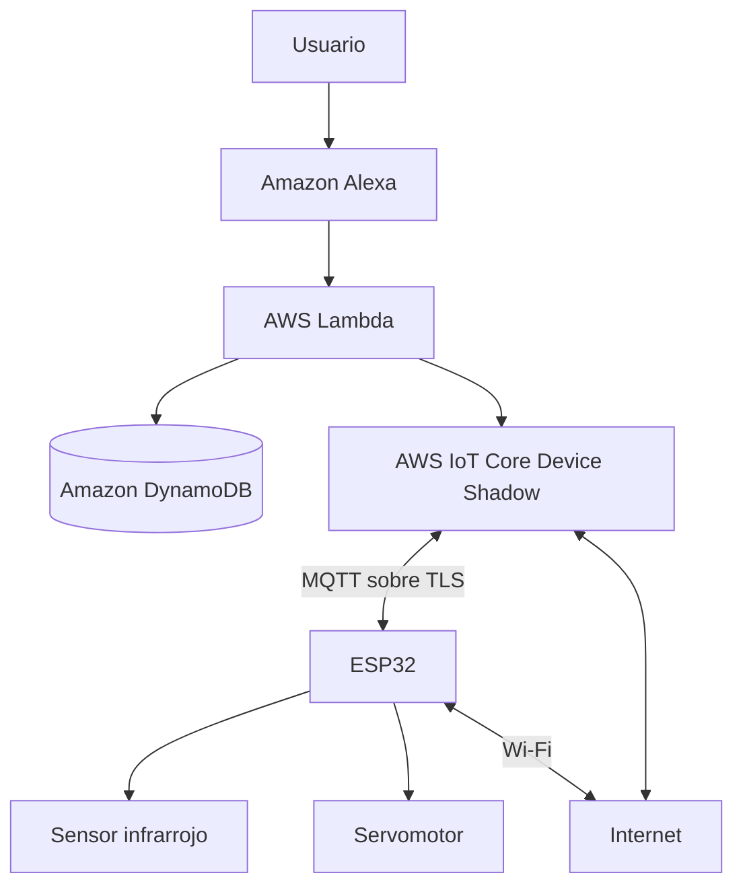

# Práctica 3: Integración de un Objeto Inteligente con Alexa y AWS IoT Core

**Asignatura:** SIS-234 – Integración de Objetos Inteligentes  
**Carrera:** Ingeniería de Sistemas  
**Proyecto:** Puerta Inteligente para Mascotas  
**Plataforma IoT:** AWS IoT Core  
**Microcontrolador:** ESP32 DOIT DevKit V1  
**Protocolo de comunicación:** MQTT sobre TLS  
**Repositorio:** [IoTPractica3](https://github.com/Lucas-RodriguezAncieta/IoTPractica3)

---

# 1. Caso de Uso y Requerimientos

## 1.1. Descripción del caso de uso

El proyecto consiste en el desarrollo de una **puerta inteligente para mascotas**, cuyo propósito es permitir el control remoto de la apertura y el cierre de una puerta mediante comandos de voz utilizando Amazon Alexa, con AWS IoT Core como plataforma intermediaria de comunicación.

El sistema está compuesto por un microcontrolador ESP32, un sensor infrarrojo de presencia y un servomotor. El sensor permite detectar la presencia de objetos dentro de su alcance, mientras que el servomotor se encarga de realizar el movimiento de apertura o cierre de la puerta.

La comunicación entre el dispositivo físico y la nube se realiza mediante el protocolo MQTT sobre una conexión TLS. AWS IoT Core administra la identidad del dispositivo y su documento Device Shadow, que permite mantener un estado deseado y un estado reportado del objeto inteligente.

La arquitectura contempla que Alexa interactúe con AWS mediante una función Lambda. Esta función será responsable de consultar y modificar el estado del dispositivo vinculado a cada usuario, utilizando una base de datos para almacenar las asociaciones entre usuarios y dispositivos.

El sistema se plantea de forma modular, de manera que en el futuro puedan incorporarse nuevos sensores, actuadores y funcionalidades sin necesidad de modificar completamente su arquitectura.

## 1.2. Justificación del sensor y actuador

### Sensor infrarrojo de presencia

Se utiliza un sensor infrarrojo porque permite detectar la presencia de objetos dentro de su rango de funcionamiento. Su función dentro del proyecto es proporcionar información sobre la detección de presencia en las proximidades de la puerta.

Es importante aclarar que el sensor no identifica específicamente animales ni distingue entre una mascota, una persona u otro objeto. Por tanto, la información obtenida representa únicamente la detección o ausencia de detección dentro de las condiciones de funcionamiento del sensor.

### Servomotor

El servomotor se utiliza como actuador para representar el movimiento de la puerta. Su posición se controla mediante señales enviadas desde el ESP32.

Se establecen dos posiciones lógicas:

- **0°:** posición de puerta cerrada.
- **180°:** posición de puerta abierta.

Estos valores representan las posiciones previstas para el prototipo y deben verificarse experimentalmente con el mecanismo físico antes de considerar que el recorrido es seguro y adecuado.

### Justificación de la integración

La combinación del sensor infrarrojo y el servomotor permite desarrollar un objeto inteligente que recopila información del entorno y ejecuta acciones físicas controladas remotamente.

El sensor no controla automáticamente el servomotor. La apertura y el cierre se realizan mediante comandos de voz que modifican el estado deseado del dispositivo en AWS IoT Core. Esto sigue el planteamiento de la práctica, que establece que el control del actuador debe realizarse mediante Alexa y el Shadow, mientras que los datos del sensor se reportan para su consulta.

## 1.3. Alcance del proyecto

El alcance previsto comprende:

1. Captura de información del entorno mediante el sensor infrarrojo.
2. Procesamiento de las lecturas mediante el ESP32.
3. Comunicación inalámbrica mediante Wi-Fi.
4. Conexión segura con AWS IoT Core utilizando MQTT sobre TLS.
5. Sincronización del estado del dispositivo mediante AWS IoT Device Shadow.
6. Control del servomotor mediante cambios en el estado deseado del Shadow.
7. Integración con una skill de Alexa mediante AWS Lambda.
8. Registro persistente de las vinculaciones entre usuarios y dispositivos mediante DynamoDB.
9. Consulta del estado del sensor y del actuador mediante comandos de voz.

**Estado actual:** el firmware del ESP32 y la estructura de comunicación con AWS IoT Core se encuentran desarrollados, pero la validación integral del sistema y la integración de Lambda, DynamoDB y Alexa deben completarse y demostrarse antes de declarar el proyecto totalmente funcional.

## 1.4. Requerimientos funcionales

Los requerimientos funcionales se definen tomando como referencia los nueve requerimientos mínimos establecidos en la guía de la práctica.

| Código | Requerimiento | Descripción |
|---|---|---|
| RF1 | Captura de datos | El ESP32 debe obtener información del entorno mediante el sensor infrarrojo. |
| RF2 | Reporte del estado | El dispositivo debe reportar periódicamente la información del sensor y el estado del actuador en la sección `reported` del Shadow. |
| RF3 | Ejecución de comandos | El dispositivo debe recibir los cambios del estado deseado mediante `delta`, aplicarlos sobre el servomotor y actualizar el estado reportado. |
| RF4 | Consulta del sensor | Alexa debe responder en español consultas sobre el valor actual del sensor, leyendo el estado `reported` del dispositivo vinculado al usuario. |
| RF5 | Control del actuador | Alexa debe permitir abrir y cerrar la puerta mediante comandos de voz que modifiquen el estado `desired` del Shadow. |
| RF6 | Consulta del actuador | Alexa debe responder consultas sobre el estado actual del actuador. |
| RF7 | Vinculación | El usuario debe poder vincular su dispositivo mediante un identificador y mantener dicha vinculación entre sesiones. |
| RF8 | Identificación del dispositivo | Lambda debe identificar el Thing asociado al usuario mediante el identificador enviado por Alexa. Si no existe una vinculación, debe informar al usuario. |
| RF9 | Administración de vinculaciones | El sistema debe verificar que el Thing exista antes de vincularlo y permitir cambiar o eliminar la vinculación. |

## 1.5. Requerimientos no funcionales

Los siguientes requerimientos establecen criterios de calidad, seguridad y funcionamiento que deben verificarse mediante pruebas.

| Código | Requerimiento | Criterio de verificación |
|---|---|---|
| RNF1 | Estabilidad | Operación continua durante al menos 10 minutos sin reinicios ni bloqueos. |
| RNF2 | Exactitud de detección | Evaluar la capacidad del sensor para detectar y no detectar objetos en condiciones controladas, registrando aciertos y errores. |
| RNF3 | Tiempo de respuesta | Medir el tiempo desde que se emite un comando de voz hasta que el ESP32 recibe y aplica la orden. Como referencia de la práctica, se considera un objetivo de hasta 3 segundos. |
| RNF4 | Frecuencia de reporte | Definir y medir el intervalo entre actualizaciones del Shadow, justificándolo según la dinámica de detección del sensor. |
| RNF5 | Reconexión | El dispositivo debe restablecer automáticamente las conexiones Wi-Fi y MQTT después de una desconexión. |
| RNF6 | Sincronización | Después de reconectarse, el dispositivo debe recuperar y aplicar el estado deseado pendiente del Shadow. |
| RNF7 | Seguridad | Las credenciales Wi-Fi, certificados y claves privadas deben mantenerse fuera del repositorio público. |
| RNF8 | Modularidad | El firmware debe mantener una estructura organizada y facilitar la incorporación de nuevos componentes. |

Los valores de referencia establecidos por la guía no deben confundirse con resultados experimentales. Su cumplimiento debe demostrarse mediante las pruebas correspondientes.

---

# 2. Análisis y Diseño

## 2.1. Arquitectura general del sistema

El sistema utiliza una arquitectura distribuida en la que el objeto inteligente se comunica con AWS IoT Core mediante MQTT sobre TLS. Alexa no se comunica directamente con el ESP32: todas las interacciones pasan por los servicios de AWS.

La arquitectura contempla los siguientes componentes:

- **ESP32:** procesa las lecturas del sensor y controla el servomotor.
- **Sensor infrarrojo:** detecta presencia de objetos.
- **Servomotor:** ejecuta el movimiento de apertura y cierre.
- **Wi-Fi:** proporciona conectividad a Internet.
- **AWS IoT Core:** administra la conexión MQTT y el Thing.
- **Device Shadow:** mantiene el estado deseado y el estado reportado.
- **AWS Lambda:** procesa las solicitudes provenientes de Alexa.
- **Amazon DynamoDB:** almacena las vinculaciones entre usuarios y Things.
- **Amazon Alexa:** permite interactuar con el sistema mediante comandos de voz.

### Diagrama de arquitectura



La comunicación entre Alexa y Lambda permite procesar las solicitudes del usuario. Lambda consulta la base de datos para identificar el dispositivo vinculado y posteriormente consulta o modifica su Shadow.

El ESP32 recibe los cambios del Shadow, ejecuta las acciones correspondientes y actualiza el estado reportado.

**Nota:** este diagrama representa la arquitectura objetivo del sistema. Los componentes Lambda, DynamoDB y Alexa deben marcarse como pendientes de implementación o validación mientras no existan evidencias de su funcionamiento real.

## 2.2. Diseño del circuito del objeto inteligente

El circuito está compuesto por el ESP32, el sensor infrarrojo y el servomotor.

La asignación de pines prevista es la siguiente:

| Componente | Pin del ESP32 | Función |
|---|---|---|
| Sensor infrarrojo OUT | GPIO 27 | Señal digital de detección |
| Sensor infrarrojo VCC | 3.3 V | Alimentación del sensor |
| Sensor infrarrojo GND | GND | Tierra |
| Servomotor señal | GPIO 18 | Señal de control PWM |
| Servomotor VCC | Alimentación de 5 V compatible | Alimentación del servomotor |
| Servomotor GND | GND común | Tierra compartida |

### Esquema lógico de conexiones

```text
             ESP32 DOIT DEVKIT V1
          ┌────────────────────────┐
          │                        │
          │ GPIO 27 ───────────────┼──── OUT Sensor IR
          │ 3.3 V ─────────────────┼──── VCC Sensor IR
          │ GND ───────────────────┼──── GND Sensor IR
          │                        │
          │ GPIO 18 ───────────────┼──── Señal Servomotor
          │ GND ───────────────────┼──── GND Servomotor
          │                        │
          └────────────────────────┘

       Alimentación del servomotor:
       Fuente compatible de 5 V
       con GND compartido con el ESP32.
```

La alimentación y el consumo eléctrico del servomotor deben verificarse antes de realizar pruebas físicas. No debe asumirse que cualquier salida de alimentación del ESP32 puede proporcionar la corriente necesaria para el motor.

La estabilidad eléctrica también debe comprobarse, ya que el consumo del servomotor puede provocar caídas de tensión y reinicios del microcontrolador.

La práctica establece que los actuadores deben operar a una tensión máxima de 12 V DC. El sistema se plantea con alimentación de baja tensión y no contempla la conmutación de cargas de 220 V AC.

## 2.3. Diseño del funcionamiento del sensor

El sensor infrarrojo proporciona una señal digital que representa la detección de un objeto dentro de su rango de funcionamiento.

El ESP32 interpreta dicha señal y genera un estado lógico:

| Estado del sensor | Interpretación |
|---|---|
| Detección activa | Se detectó un objeto dentro del alcance del sensor. |
| Detección inactiva | El sensor no detecta un objeto dentro de sus condiciones de funcionamiento. |

La ausencia de detección no garantiza que el paso esté libre, debido a las limitaciones propias del sensor, su orientación, alcance y condiciones ambientales.

Por esta razón, el sistema no debe utilizar la lectura del sensor como una garantía de seguridad para cerrar una puerta sobre una mascota.

## 2.4. Diseño del funcionamiento del servomotor

El servomotor recibe una orden del ESP32 y cambia a la posición correspondiente.

| Estado lógico | Posición prevista |
|---|---:|
| `closed` | 0° |
| `open` | 180° |

La orden se origina en Alexa, se procesa mediante AWS y se refleja en el estado deseado del Shadow.

El ESP32 recibe el cambio y ejecuta el movimiento si el control del servomotor se encuentra habilitado.

El firmware contempla que el servomotor no realice un movimiento inicial automático al arrancar. Esta decisión evita movimientos inesperados durante la inicialización del dispositivo.

## 2.5. Diseño del documento AWS IoT Device Shadow

El Device Shadow permite mantener una representación virtual del estado del objeto inteligente.

Se utilizan tres conceptos principales:

- **desired:** representa el estado solicitado por el usuario o por una aplicación.
- **reported:** representa el estado que comunica el dispositivo.
- **delta:** representa las diferencias entre el estado deseado y el estado reportado.

Para el proyecto se plantea la siguiente estructura lógica:

```json
{
  "state": {
    "desired": {
      "door": "open"
    },
    "reported": {
      "objectDetected": false,
      "door": "closed",
      "servoAngle": 0
    }
  }
}
```

Los atributos representan:

| Atributo | Tipo | Valores o significado |
|---|---|---|
| `door` | String | `open` o `closed` |
| `objectDetected` | Boolean | `true` si existe detección y `false` si no existe detección |
| `servoAngle` | Number | Ángulo lógico reportado por el firmware |

Los valores anteriores describen el modelo de datos previsto. Deben mantenerse consistentes con los nombres y tipos utilizados realmente en el firmware y en los servicios de AWS.

### Ejemplo de apertura

Cuando el usuario solicita abrir la puerta, el estado deseado se modifica:

```json
{
  "state": {
    "desired": {
      "door": "open"
    }
  }
}
```

AWS IoT Core comunica el cambio al dispositivo mediante el mecanismo de sincronización del Shadow.

El ESP32 recibe la diferencia, procesa la orden y, si el movimiento está habilitado, establece la posición prevista de apertura.

Después de ejecutar la acción, el dispositivo debe actualizar `reported`.

### Ejemplo de cierre

```json
{
  "state": {
    "desired": {
      "door": "closed"
    }
  }
}
```

El ESP32 procesa la solicitud y ejecuta la posición de cierre cuando las condiciones de funcionamiento lo permiten.

### Consideración importante sobre el estado reportado

Una respuesta `update/accepted` de AWS IoT Core solamente confirma que AWS aceptó una actualización del Shadow. No demuestra que el servomotor haya realizado físicamente el movimiento.

Asimismo, `servoAngle` es un valor comunicado por el firmware y no una medición física independiente de la posición real del mecanismo.

Para afirmar que la puerta se encuentra físicamente abierta o cerrada sería necesario validar el mecanismo o incorporar un sistema de realimentación física.

## 2.6. Diseño del mecanismo de vinculación usuario–Thing

La práctica requiere que la skill de Alexa no dependa de un único dispositivo. Cada usuario debe poder utilizar su propio Thing.

Para cumplir este objetivo, se plantea utilizar Amazon DynamoDB como almacenamiento persistente de las vinculaciones.

La estructura propuesta es:

| Campo | Tipo | Descripción |
|---|---|---|
| `userId` | String | Identificador del usuario proporcionado por Alexa. |
| `thingName` | String | Nombre del Thing vinculado. |
| `fechaVinculacion` | String | Fecha y hora de la vinculación. |

El identificador del usuario se obtiene de la solicitud de Alexa mediante:

```text
context.System.user.userId
```

La lógica prevista es:

1. El usuario solicita vincular su puerta inteligente.
2. Alexa recibe el identificador proporcionado.
3. Lambda verifica que el Thing exista en AWS IoT Core.
4. Si existe, registra la relación entre el usuario y el Thing en DynamoDB.
5. En las siguientes solicitudes, Lambda consulta la base de datos para determinar qué dispositivo corresponde al usuario.
6. Si el usuario desea cambiar de dispositivo, se actualiza la vinculación.
7. Si desea desvincularlo, se elimina el registro correspondiente.

La vinculación debe persistir entre sesiones.

**Estado actual:** la estructura y el comportamiento de vinculación están definidos como parte del diseño. La implementación de Lambda y DynamoDB debe completarse y validarse antes de declarar RF7, RF8 y RF9 como cumplidos.

## 2.7. Diseño de la skill de Alexa

La skill permitirá controlar la puerta inteligente mediante instrucciones en español.

La interacción prevista comprende:

- Invocación de la skill.
- Vinculación de un dispositivo.
- Consulta de presencia detectada.
- Apertura de la puerta.
- Cierre de la puerta.
- Consulta del estado de la puerta.
- Cambio de dispositivo vinculado.
- Desvinculación.

### Modelo de interacción previsto

| Funcionalidad | Acción esperada |
|---|---|
| Invocar skill | Iniciar la interacción con la puerta inteligente. |
| Vincular dispositivo | Asociar el Thing con el usuario actual. |
| Consultar sensor | Obtener el último estado reportado del sensor. |
| Abrir puerta | Modificar `desired.door` a `open`. |
| Cerrar puerta | Modificar `desired.door` a `closed`. |
| Consultar puerta | Leer el valor de `reported.door`. |
| Cambiar vinculación | Asociar otro Thing al usuario. |
| Desvincular | Eliminar la asociación almacenada. |

### Frases de ejemplo previstas

- "Alexa, abre puerta inteligente".
- "Abre la puerta".
- "Cierra la puerta".
- "¿La puerta está abierta?"
- "¿Se detecta algún objeto?"
- "Vincula mi puerta inteligente".
- "Desvincula mi puerta".

Estas frases representan ejemplos de interacción que deben configurarse y probarse en la Alexa Developer Console. No constituyen evidencia de que la skill ya se encuentre implementada.

---

# 3. Desarrollo e Implementación

## 3.1. Entorno de desarrollo

El firmware del objeto inteligente se desarrolla utilizando PlatformIO, el framework Arduino y el microcontrolador ESP32.

La configuración de la placa se basa en:

| Parámetro | Configuración |
|---|---|
| Microcontrolador | ESP32 DOIT DevKit V1 |
| Entorno | PlatformIO |
| Framework | Arduino |
| Plataforma | `espressif32` |
| Versión de plataforma | `7.0.1` |
| Placa | `esp32doit-devkit-v1` |
| Monitor serial | 115200 baudios |
| Comunicación con AWS | MQTT sobre TLS |
| Puerto MQTT TLS | 8883 |

La configuración debe verificarse con la placa física utilizada durante la práctica.

## 3.3. Configuración del ESP32

El ESP32 es el componente principal del objeto inteligente. Se encarga de inicializar los periféricos, conectarse a la red inalámbrica, establecer la comunicación con AWS IoT Core y procesar los cambios recibidos mediante el Shadow.

La configuración del dispositivo incluye:

- Nombre del Thing: `puerta-mascotas-01`.
- Endpoint de AWS IoT Core correspondiente a la región configurada.
- Puerto de comunicación TLS: `8883`.
- Tópicos de comunicación del Device Shadow.
- Credenciales Wi-Fi.
- Certificado del dispositivo.
- Clave privada.
- Certificado de la autoridad certificadora correspondiente.

Las credenciales y los certificados se mantienen en archivos locales excluidos del repositorio.

Los archivos de ejemplo no deben contener información real de conexión ni claves privadas.

## 3.4. Seguridad de las credenciales

Para proteger la información sensible se utilizan dos archivos locales:

- `include/config.h`: contiene la configuración de red y los parámetros del dispositivo.
- `include/secrets.h`: contiene los certificados y la clave privada necesarios para la conexión segura.

El repositorio incluye plantillas:

- `include/config.example.h`
- `include/secrets.example.h`

Los archivos reales se excluyen mediante `.gitignore`.

Esta separación permite compartir el código fuente sin publicar las credenciales del dispositivo.

**Nunca deben subirse al repositorio público:**

- Contraseñas Wi-Fi.
- Certificados privados.
- Claves privadas.
- Claves de acceso de AWS.
- Credenciales personales.

## 3.5. Comunicación MQTT sobre TLS

La comunicación entre el ESP32 y AWS IoT Core se realiza mediante MQTT sobre TLS.

MQTT es un protocolo ligero de mensajería basado en el modelo publicación/suscripción. Permite que los dispositivos intercambien información mediante tópicos sin necesitar una conexión directa entre cada participante.

TLS proporciona cifrado y autenticación durante la conexión.

El ESP32 utiliza el endpoint de AWS IoT Core y los certificados configurados para establecer una conexión segura.

El puerto utilizado es:

```text
8883
```

La conexión segura requiere que el dispositivo tenga configurados correctamente:

- Endpoint ATS de AWS IoT Core.
- Puerto TLS.
- Certificado de la autoridad certificadora.
- Certificado del dispositivo.
- Clave privada del dispositivo.
- Hora válida para la verificación de certificados.

La sincronización horaria mediante NTP es necesaria para que la validación temporal de los certificados funcione correctamente.

## 3.6. Comunicación con AWS IoT Device Shadow

El firmware utiliza los tópicos reservados de AWS IoT Device Shadow para consultar y modificar el estado del dispositivo.

Para el Thing `puerta-mascotas-01`, los tópicos principales son:

| Tópico | Función |
|---|---|
| `$aws/things/puerta-mascotas-01/shadow/get` | Solicitar el estado actual del Shadow. |
| `$aws/things/puerta-mascotas-01/shadow/get/accepted` | Recibir la respuesta aceptada de la consulta. |
| `$aws/things/puerta-mascotas-01/shadow/get/rejected` | Recibir errores de consulta. |
| `$aws/things/puerta-mascotas-01/shadow/update` | Publicar actualizaciones del estado. |
| `$aws/things/puerta-mascotas-01/shadow/update/accepted` | Confirmar que AWS aceptó una actualización. |
| `$aws/things/puerta-mascotas-01/shadow/update/rejected` | Informar errores de actualización. |
| `$aws/things/puerta-mascotas-01/shadow/update/delta` | Recibir diferencias entre `desired` y `reported`. |

La consulta inicial del Shadow se realiza publicando:

```json
{}
```

en:

```text
$aws/things/puerta-mascotas-01/shadow/get
```

Una solicitud de apertura puede representarse mediante:

```json
{
  "state": {
    "desired": {
      "door": "open"
    }
  }
}
```

Una solicitud de cierre puede representarse mediante:

```json
{
  "state": {
    "desired": {
      "door": "closed"
    }
  }
}
```

El dispositivo procesa los cambios recibidos mediante `delta` y actualiza el estado `reported` después de aplicar la acción correspondiente.

## 3.7. Configuración de AWS IoT Core

En AWS IoT Core se contempla la creación y configuración de un Thing que representa al objeto inteligente.

El nombre definido para el dispositivo inicial es:

```text
puerta-mascotas-01
```

La configuración contempla:

1. Registro del Thing.
2. Creación de certificados.
3. Activación del certificado del dispositivo.
4. Asociación de una política de AWS IoT.
5. Configuración del endpoint MQTT.
6. Sincronización mediante Device Shadow.

La política del dispositivo debe limitar los permisos a los recursos y operaciones necesarios.

El archivo:

```text
aws/iot-policy.example.json
```

sirve como referencia para documentar la política. Debe verificarse que sus permisos coincidan con los tópicos y el identificador de cliente utilizados realmente.

## 3.8. Pruebas de comunicación mediante MQTT.fx

MQTT.fx puede utilizarse como herramienta externa para diagnosticar la comunicación con AWS IoT Core.

La configuración de diagnóstico debe utilizar:

- Endpoint ATS de AWS IoT Core.
- Puerto `8883`.
- TLS 1.2.
- Certificado de una identidad autorizada.
- Clave privada correspondiente.
- Identificador de cliente único.

El identificador de cliente de MQTT.fx debe ser distinto al del ESP32 para evitar conflictos de sesión.

También deben existir permisos adecuados en la política asociada al certificado utilizado por MQTT.fx.

La política de ejemplo del dispositivo puede no autorizar automáticamente las conexiones de diagnóstico. Si se necesita una identidad independiente para MQTT.fx, debe configurarse una política específica con permisos limitados.

Para verificar el Shadow se pueden realizar las siguientes operaciones:

1. Conectar MQTT.fx con TLS.
2. Suscribirse a los tópicos de respuesta del Shadow.
3. Publicar `{}` en el tópico `shadow/get`.
4. Comprobar la respuesta recibida.
5. Publicar una solicitud de apertura o cierre en `shadow/update`.
6. Observar la respuesta de AWS.
7. Verificar si el ESP32 recibe la diferencia correspondiente.
8. Comprobar el estado reportado por el dispositivo.

Una respuesta aceptada de AWS no debe interpretarse como confirmación de movimiento físico del servomotor.

## 3.9. Desarrollo de AWS Lambda

La función AWS Lambda está contemplada como backend de la skill de Alexa.

Su responsabilidad es procesar las solicitudes recibidas, identificar al usuario y consultar la vinculación almacenada en DynamoDB.

El funcionamiento previsto es:

1. Recibir la solicitud de Alexa.
2. Obtener el identificador del usuario.
3. Consultar DynamoDB.
4. Recuperar el nombre del Thing asociado.
5. Consultar o modificar el Shadow correspondiente.
6. Procesar la respuesta de AWS.
7. Generar una respuesta en español para Alexa.

La función debe contemplar situaciones como:

- Usuario sin dispositivo vinculado.
- Thing inexistente.
- Solicitud de apertura.
- Solicitud de cierre.
- Consulta del sensor.
- Consulta del estado del actuador.
- Cambio de vinculación.
- Desvinculación.
- Error de comunicación con AWS.

**Estado actual:** la implementación y validación de esta función se encuentran pendientes. Por tanto, no se afirma que las operaciones anteriores ya estén funcionando.

## 3.10. Desarrollo de Amazon DynamoDB

DynamoDB se propone como almacenamiento persistente para registrar la asociación entre usuarios y dispositivos.

La tabla debe permitir recuperar el Thing correspondiente a cada usuario.

El modelo de datos propuesto es:

```json
{
  "userId": "IDENTIFICADOR_USUARIO_ALEXA",
  "thingName": "puerta-mascotas-01",
  "fechaVinculacion": "FECHA_HORA"
}
```

La clave de partición propuesta es `userId`.

Las operaciones necesarias contemplan:

- Consultar una vinculación.
- Registrar una vinculación.
- Actualizar una vinculación.
- Eliminar una vinculación.

**Estado actual:** el diseño de la tabla está definido, pero su creación, configuración y funcionamiento deben verificarse antes de declarar esta parte como implementada.

## 3.12. Desarrollo de la skill de Alexa

La skill constituye la interfaz de interacción con el usuario.

Su función es interpretar las solicitudes de voz y enviarlas al backend Lambda.

La skill no debe comunicarse directamente con el ESP32. Toda operación sobre el dispositivo debe realizarse mediante AWS IoT Core y su Device Shadow.

La configuración debe contemplar:

- Nombre de invocación.
- Intents.
- Slots necesarios.
- Frases de ejemplo.
- Respuestas en español.
- Vinculación con AWS Lambda.

**Estado actual:** el diseño de interacción está definido, pero la configuración y validación de la skill deben completarse y documentarse con evidencias de la Alexa Developer Console.

## 3.13. Consideraciones de seguridad física

El proyecto contempla un mecanismo físico de baja tensión para representar la apertura y cierre de una puerta.

Sin embargo, el diseño mecánico definitivo y las medidas de protección contra atrapamientos no se encuentran verificadas.

Además, el firmware contempla que el movimiento del servomotor permanezca deshabilitado durante la inicialización. Si se habilita posteriormente, una orden antigua que permanezca pendiente en el Shadow podría ejecutarse al conectar o reconectar el dispositivo.

Por esta razón:

- No se debe utilizar el prototipo con animales.
- Las pruebas del servomotor deben realizarse con el mecanismo desacoplado.
- Debe comprobarse el recorrido del servo.
- Deben verificarse los límites mecánicos.
- Debe evaluarse la alimentación eléctrica.
- Debe evitarse cualquier posibilidad de atrapamiento.
- Debe incorporarse una estrategia de seguridad antes de considerar una instalación real.

---

# 4. Pruebas y Validaciones

## 4.1. Objetivo de las pruebas

El objetivo de las pruebas es verificar el funcionamiento de los componentes individuales y la integración del sistema.

Se busca comprobar que el ESP32 capture correctamente la información del sensor, mantenga la comunicación con AWS IoT Core, sincronice el estado mediante Device Shadow y ejecute las órdenes recibidas.

También se deben validar las operaciones de Alexa, Lambda y DynamoDB una vez que dichos componentes se encuentren implementados.

Las pruebas deben documentarse con fecha, responsable, condiciones de ejecución, resultado obtenido y evidencia.

**Importante:** las pruebas enumeradas en esta sección constituyen un plan de validación. No se presentan como ejecutadas ni aprobadas mientras no existan registros experimentales que lo demuestren.

## 4.2. Condiciones generales de prueba

| Elemento | Descripción |
|---|---|
| Microcontrolador | ESP32 DOIT DevKit V1 |
| Sensor | Sensor infrarrojo de presencia |
| Actuador | Servomotor |
| Plataforma IoT | AWS IoT Core |
| Comunicación | MQTT sobre TLS |
| Puerto | 8883 |
| Herramienta de diagnóstico | Monitor serial y MQTT.fx |
| Estado del dispositivo | Thing `puerta-mascotas-01` |
| Condición de seguridad | Pruebas del servomotor sin animales y con mecanismo desacoplado |

## 4.3. Matriz de pruebas funcionales

| ID | Prueba | Procedimiento | Resultado esperado | Estado |
|---|---|---|---|---|
| P01 | Inicialización ESP32 | Encender el dispositivo. | El firmware inicia sin bloqueos. | Pendiente de validación |
| P02 | Inicialización sensor | Verificar la configuración del sensor. | El sensor queda disponible para lectura. | Pendiente de validación |
| P03 | Detección de presencia | Colocar un objeto dentro del alcance. | El sensor registra detección. | Pendiente de validación |
| P04 | Ausencia de presencia | Retirar el objeto del alcance. | El sensor registra ausencia de detección. | Pendiente de validación |
| P05 | Conexión Wi-Fi | Iniciar el dispositivo con la red disponible. | El ESP32 establece conexión. | Pendiente de validación |
| P06 | Conexión MQTT/TLS | Conectar con AWS IoT Core. | La conexión segura se establece correctamente. | Pendiente de validación |
| P07 | Consulta del Shadow | Publicar una solicitud `get`. | AWS devuelve el estado del dispositivo. | Pendiente de validación |
| P08 | Reporte del sensor | Generar una lectura del sensor. | El estado se refleja en `reported`. | Pendiente de validación |
| P09 | Solicitud de apertura | Publicar `desired.door = open`. | El dispositivo recibe la orden. | Pendiente de validación |
| P10 | Solicitud de cierre | Publicar `desired.door = closed`. | El dispositivo recibe la orden. | Pendiente de validación |
| P11 | Aplicación de apertura | Ejecutar la orden con movimiento habilitado y condiciones seguras. | El servo alcanza la posición prevista. | Pendiente de validación |
| P12 | Aplicación de cierre | Ejecutar la orden con movimiento habilitado y condiciones seguras. | El servo alcanza la posición prevista. | Pendiente de validación |
| P13 | Actualización de reported | Consultar el Shadow después de ejecutar una orden. | El dispositivo comunica el estado aplicado. | Pendiente de validación |
| P14 | Pérdida de Wi-Fi | Desconectar temporalmente la red. | El dispositivo detecta la desconexión. | Pendiente de validación |
| P15 | Reconexión Wi-Fi | Restablecer la red. | El dispositivo recupera la conexión. | Pendiente de validación |
| P16 | Reconexión MQTT | Interrumpir y restablecer la conexión MQTT. | El dispositivo vuelve a conectarse. | Pendiente de validación |
| P17 | Sincronización pendiente | Dejar una orden deseada pendiente y reconectar. | El dispositivo recupera el estado deseado. | Pendiente de validación |
| P18 | Estabilidad | Mantener el sistema funcionando al menos 10 minutos. | No se producen reinicios ni bloqueos. | Pendiente de validación |
| P19 | Actualización aceptada | Publicar una actualización válida. | AWS responde con `update/accepted`. | Pendiente de validación |
| P20 | Actualización rechazada | Enviar una actualización inválida. | AWS devuelve un rechazo o error. | Pendiente de validación |
| P21 | Recepción de delta | Modificar el estado deseado. | El dispositivo recibe la diferencia correspondiente. | Pendiente de validación |
| P22 | Diagnóstico MQTT.fx | Conectar una identidad autorizada y consultar el Shadow. | Se reciben las respuestas correspondientes. | Pendiente de validación |

## 4.4. Pruebas de integración de Alexa y AWS

Las siguientes pruebas dependen de la implementación de Lambda, DynamoDB y Alexa.

| ID | Prueba | Resultado esperado | Estado |
|---|---|---|---|
| P23 | Vinculación de un Thing | El usuario registra correctamente su dispositivo. | Pendiente de implementación y validación |
| P24 | Validación de Thing inexistente | El sistema rechaza una vinculación inválida. | Pendiente de implementación y validación |
| P25 | Persistencia de vinculación | La asociación permanece entre sesiones. | Pendiente de implementación y validación |
| P26 | Consulta del sensor desde Alexa | Alexa responde con el último dato reportado. | Pendiente de implementación y validación |
| P27 | Apertura por voz | Alexa modifica el estado deseado y el ESP32 recibe la orden. | Pendiente de implementación y validación |
| P28 | Cierre por voz | Alexa modifica el estado deseado y el ESP32 recibe la orden. | Pendiente de implementación y validación |
| P29 | Consulta del actuador | Alexa responde con el estado reportado. | Pendiente de implementación y validación |
| P30 | Cambio de vinculación | El usuario puede asociar otro Thing. | Pendiente de implementación y validación |
| P31 | Desvinculación | El usuario puede eliminar la asociación. | Pendiente de implementación y validación |
| P32 | Usuario sin vinculación | Alexa informa que no existe un dispositivo asociado. | Pendiente de implementación y validación |
| P33 | Aislamiento entre usuarios | Cada usuario accede únicamente a su Thing vinculado. | Pendiente de implementación y validación |

## 4.5. Validación de exactitud del sensor

Debido a que el sensor utilizado es digital, la evaluación debe centrarse en su capacidad de detectar o no detectar objetos en condiciones controladas.

Se propone realizar 30 ensayos:

- 15 ensayos con un objeto presente dentro del rango de detección.
- 15 ensayos sin objetos dentro del rango de detección.

Los resultados deben registrarse en una tabla.

| Métrica | Fórmula |
|---|---|
| Tasa de aciertos positivos | Verdaderos positivos / Total de objetos presentes × 100 |
| Tasa de aciertos negativos | Verdaderos negativos / Total de objetos ausentes × 100 |
| Falsos positivos | Detecciones cuando no existe un objeto. |
| Falsos negativos | Ausencia de detección cuando existe un objeto. |

La evaluación debe considerar la distancia, orientación, condiciones de iluminación y características del objeto utilizado.

No se debe interpretar esta prueba como una medición de distancia ni como una identificación de mascotas.

## 4.6. Validación del tiempo de respuesta

El tiempo de respuesta debe medirse desde que se emite una orden de voz hasta que el ESP32 recibe y aplica la solicitud.

La medición debe considerar la secuencia completa:

```text
Alexa
  ↓
AWS Lambda
  ↓
AWS IoT Core
  ↓
Device Shadow
  ↓
ESP32
  ↓
Servomotor
```

La referencia indicada por la práctica es un tiempo máximo de 3 segundos.

Se recomienda registrar varias mediciones para obtener:

- Tiempo mínimo.
- Tiempo máximo.
- Tiempo promedio.
- Número de ensayos.
- Condiciones de red.

También debe diferenciarse el tiempo de recepción de la orden del tiempo que tarda el mecanismo físico en completar el movimiento.

## 4.7. Validación de la frecuencia de reporte

La frecuencia de reporte debe justificarse según el comportamiento del sensor y la necesidad del caso de uso.

Para este proyecto se recomienda combinar:

1. Reporte por evento cuando cambie el estado de detección.
2. Reporte periódico de respaldo para mantener actualizado el Shadow.

El intervalo definitivo debe obtenerse del firmware y verificarse mediante mediciones reales.

También debe considerarse el consumo de mensajes de AWS IoT Core, evitando publicaciones innecesarias.

## 4.8. Validación de reconexión y sincronización

La reconexión es importante para garantizar que el dispositivo pueda recuperarse después de interrupciones de red.

Se propone realizar cinco ciclos de desconexión y reconexión.

En cada ciclo se debe:

1. Verificar que el dispositivo esté conectado.
2. Interrumpir la conexión Wi-Fi o MQTT.
3. Registrar el comportamiento del firmware.
4. Restablecer la conexión.
5. Comprobar que el ESP32 vuelva a conectarse.
6. Consultar el Shadow.
7. Verificar si existe un estado deseado pendiente.
8. Comprobar que el dispositivo procese la orden correspondiente.

Debe prestarse especial atención a las órdenes antiguas pendientes, especialmente las que podrían provocar el cierre de la puerta.

## 4.9. Ficha de registro de pruebas

Cada prueba ejecutada debe documentarse mediante una ficha como la siguiente:

| Campo | Información |
|---|---|
| Código de prueba | Identificador único |
| Fecha y hora | Fecha y hora real de ejecución |
| Responsable | Integrante que realizó la prueba |
| Firmware | Versión o commit probado |
| Dispositivo | ESP32 DOIT DevKit V1 |
| Entorno | Condiciones de red y montaje |
| Objetivo | Qué se pretende verificar |
| Precondiciones | Estado inicial del sistema |
| Procedimiento | Pasos realizados |
| Resultado esperado | Comportamiento previsto |
| Resultado obtenido | Comportamiento observado |
| Estado | Aprobada, fallida o no ejecutada |
| Evidencia | Fotografía, captura o registro serial |

No deben completarse los campos de resultados con valores supuestos. Los datos deben proceder de las ejecuciones reales.

---

# 5. Resultados

## 5.1. Estado general del desarrollo

El desarrollo del proyecto contempla diferentes componentes que deben integrarse para conseguir el funcionamiento completo del sistema.

Con la información disponible del desarrollo, el estado se resume de la siguiente manera:

| Componente | Estado | Observación |
|---|---|---|
| Estructura del proyecto | Desarrollada | Organización del firmware y directorios del proyecto. |
| Configuración del ESP32 | Desarrollada | Configuración para la placa ESP32 DOIT DevKit V1. |
| Sensor infrarrojo | Integrado en el diseño | Requiere validación experimental. |
| Servomotor | Integrado en el diseño del firmware | Movimiento físico y seguridad pendientes de validación. |
| Comunicación MQTT/TLS | Implementada en el firmware | Requiere pruebas de conexión y estabilidad. |
| AWS IoT Core | Configuración contemplada | Debe documentarse con evidencias de la configuración real. |
| Device Shadow | Implementado en el firmware | Su comportamiento integral requiere validación. |
| AWS Lambda | Pendiente | Debe implementarse y probarse. |
| DynamoDB | Pendiente | Debe crearse y validarse la tabla de vinculaciones. |
| Skill de Alexa | Pendiente | Debe configurarse y probarse mediante el simulador. |
| Integración completa | Pendiente | Depende de la validación de todos los componentes. |

## 5.2. Resultados del firmware

El firmware constituye la base del objeto inteligente.

Se ha desarrollado para permitir la inicialización del ESP32, la lectura del sensor, la comunicación con AWS IoT Core y el procesamiento de los cambios del Device Shadow.

El diseño contempla que el dispositivo mantenga una comunicación segura mediante MQTT sobre TLS y que los estados del objeto se representen mediante `desired` y `reported`.

Sin embargo, el funcionamiento físico del servomotor, la estabilidad de la alimentación y la recuperación ante desconexiones deben comprobarse mediante ensayos documentados.

## 5.3. Resultados de AWS IoT Core

AWS IoT Core constituye el intermediario entre el objeto inteligente y los servicios de aplicación.

El uso de Device Shadow permite separar las órdenes solicitadas del estado que comunica el dispositivo.

Esta separación es importante porque una solicitud de apertura o cierre no implica que el mecanismo haya ejecutado correctamente la acción.

Por tanto, la evaluación debe considerar tanto la respuesta de AWS como el estado reportado posteriormente por el ESP32.

## 5.4. Resultados cuantitativos

Los resultados cuantitativos deben completarse después de ejecutar las pruebas.

| Indicador | Valor obtenido |
|---|---|
| Duración de prueba de estabilidad | Por medir |
| Reinicios durante la prueba | Por medir |
| Porcentaje de detecciones correctas | Por medir |
| Porcentaje de ausencias correctamente identificadas | Por medir |
| Tiempo mínimo de respuesta | Por medir |
| Tiempo promedio de respuesta | Por medir |
| Tiempo máximo de respuesta | Por medir |
| Intervalo real de reporte | Por medir |
| Ciclos de reconexión exitosos | Por medir |

Los campos anteriores no representan resultados negativos ni positivos. Indican que todavía se necesita realizar y documentar la medición correspondiente.

## 5.5. Análisis de limitaciones

Durante el análisis del sistema se identifican las siguientes limitaciones:

1. El sensor infrarrojo detecta objetos, pero no identifica específicamente mascotas.
2. La ausencia de detección no garantiza que el paso esté libre.
3. El valor reportado del ángulo del servo no representa una medición física independiente.
4. La alimentación del servomotor puede afectar la estabilidad eléctrica del ESP32.
5. Una orden pendiente en el Shadow puede ejecutarse después de una reconexión si el firmware está habilitado para procesarla.
6. El mecanismo físico todavía requiere medidas de seguridad contra atrapamientos.
7. La integración completa depende de la implementación y validación de Lambda, DynamoDB y Alexa.

Estas limitaciones deben considerarse antes de utilizar el prototipo en un entorno real.

---

# 6. Conclusiones

El desarrollo de la puerta inteligente para mascotas permite aplicar conceptos fundamentales de Internet de las Cosas mediante la integración de un microcontrolador ESP32, sensores, actuadores, comunicación MQTT sobre TLS y servicios de AWS IoT Core.

El uso de AWS IoT Device Shadow permite mantener una representación virtual del estado del objeto inteligente, diferenciando las acciones solicitadas de los estados comunicados por el dispositivo.

Esta separación facilita la sincronización entre el objeto físico y los servicios en la nube, además de permitir que otros componentes, como Alexa y AWS Lambda, interactúen con el dispositivo sin establecer una comunicación directa con el microcontrolador.

El proyecto también evidencia la importancia de diseñar una arquitectura modular y segura, especialmente cuando se integran dispositivos físicos con plataformas en la nube.

No obstante, el funcionamiento completo del sistema depende de validar el movimiento físico del servomotor, la estabilidad de la alimentación, la recuperación de conexiones y la integración de los servicios de backend.

Asimismo, se concluye que un sensor de presencia no es suficiente para garantizar la seguridad de una puerta destinada a mascotas. Para una implementación real sería necesario incorporar mecanismos adicionales de protección y realimentación física.

En consecuencia, el proyecto representa una base de desarrollo para un sistema de control remoto mediante IoT, pero todavía requiere completar y validar los componentes pendientes antes de considerarse una solución funcional y segura para uso cotidiano.

---

# 7. Recomendaciones

A partir del diseño y desarrollo del proyecto, se plantean las siguientes recomendaciones:

1. **Completar la integración de AWS Lambda:** implementar el procesamiento de solicitudes de Alexa y la comunicación con el Device Shadow.

2. **Implementar DynamoDB:** almacenar de manera persistente las asociaciones entre los usuarios y sus dispositivos.

3. **Finalizar la skill de Alexa:** configurar los intents, slots, frases de ejemplo y respuestas en español.

4. **Validar la comunicación MQTT/TLS:** realizar pruebas de conexión, desconexión, reconexión y sincronización del Shadow.

5. **Medir el tiempo de respuesta:** registrar el tiempo completo desde el comando de voz hasta la aplicación de la orden en el ESP32.

6. **Evaluar el sensor infrarrojo:** realizar ensayos con objetos de diferentes tamaños, posiciones y distancias para identificar sus limitaciones.

7. **Mejorar la alimentación eléctrica:** comprobar que el servomotor reciba una alimentación compatible y estable, evitando reinicios del ESP32.

8. **Incorporar medidas de seguridad física:** añadir sensores o mecanismos que permitan detectar obstáculos y evitar el cierre cuando exista riesgo de atrapamiento.

9. **Controlar las órdenes pendientes:** definir una estrategia segura para procesar estados deseados antiguos después de una reconexión.

10. **Aplicar el principio de mínimo privilegio:** limitar los permisos de las políticas de AWS IoT y del rol IAM de Lambda a las operaciones necesarias.

11. **Proteger las credenciales:** mantener certificados, claves privadas y contraseñas fuera del repositorio.

12. **Documentar todas las pruebas:** registrar las condiciones, mediciones y evidencias para respaldar las conclusiones del proyecto.

13. **Ampliar la arquitectura:** considerar la incorporación de nuevos sensores y actuadores sin modificar completamente el diseño existente.

---

# 8. Anexos

 del proyecto y estar respaldada por evidencias verificables.
