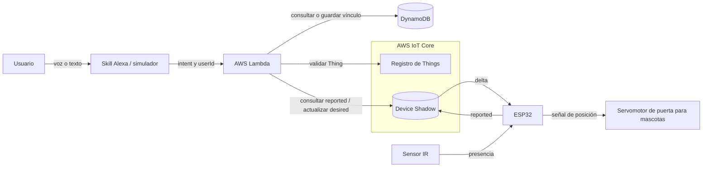
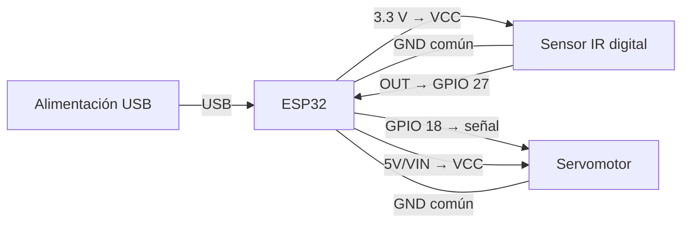
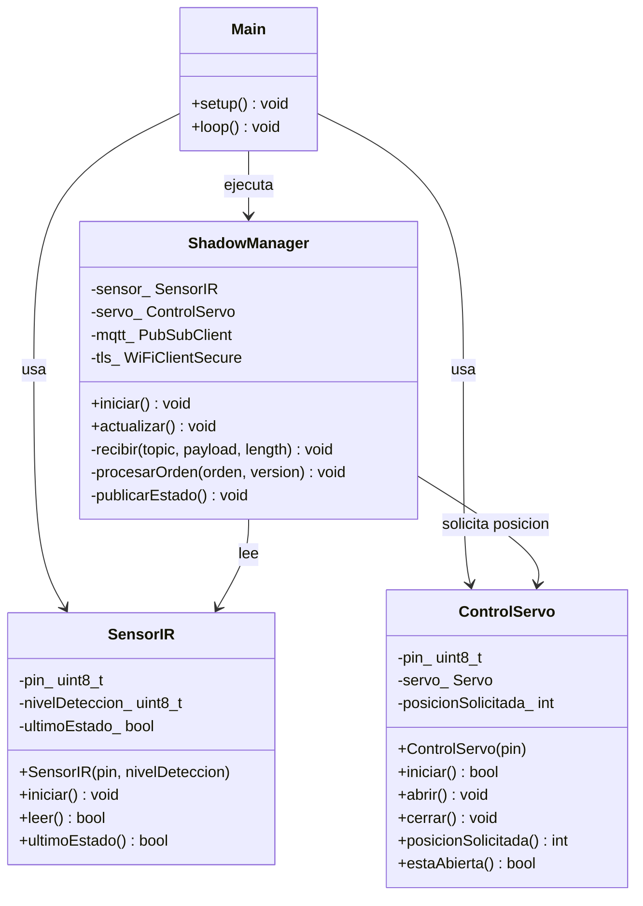
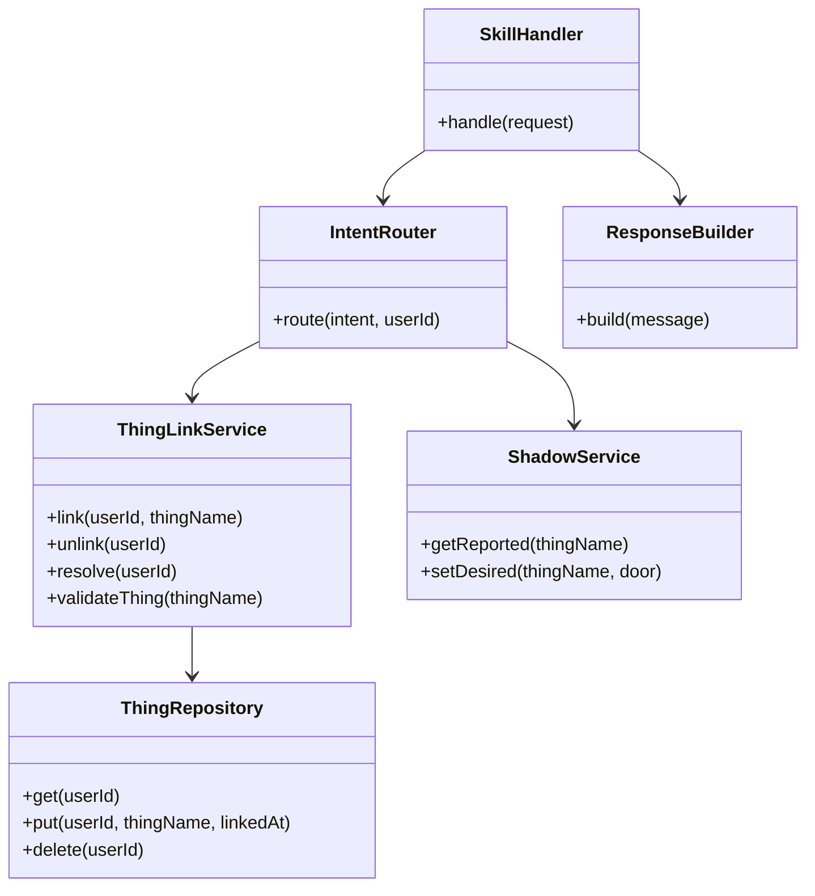
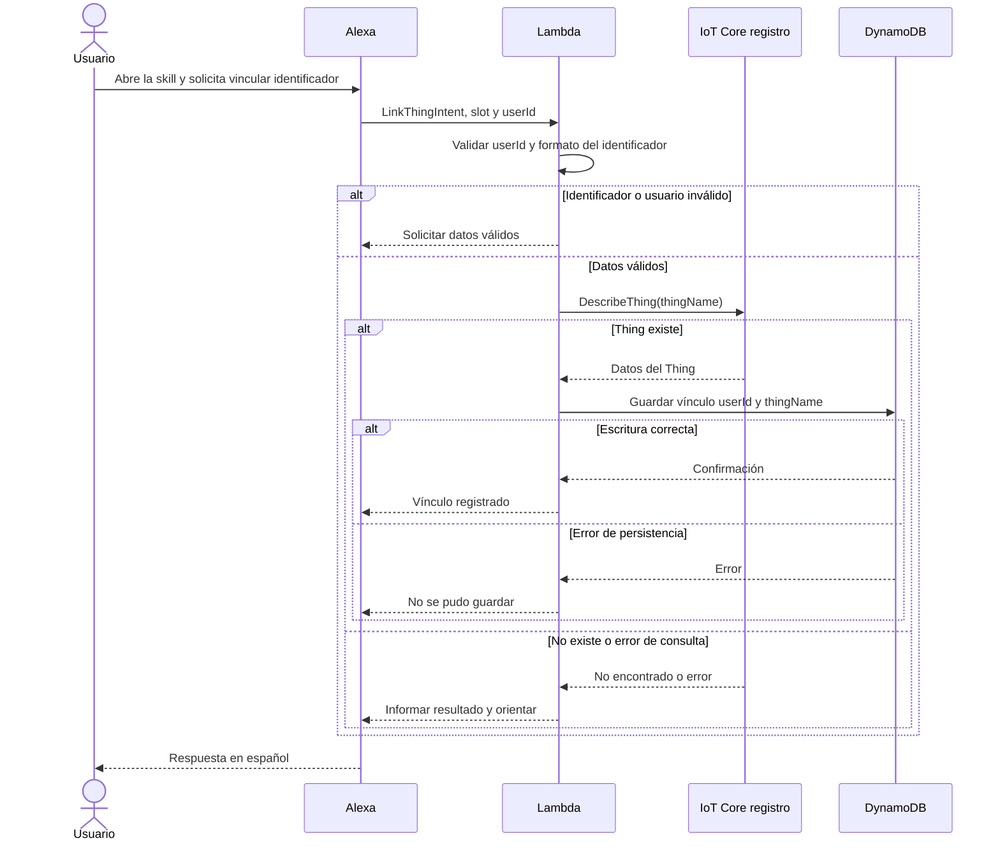
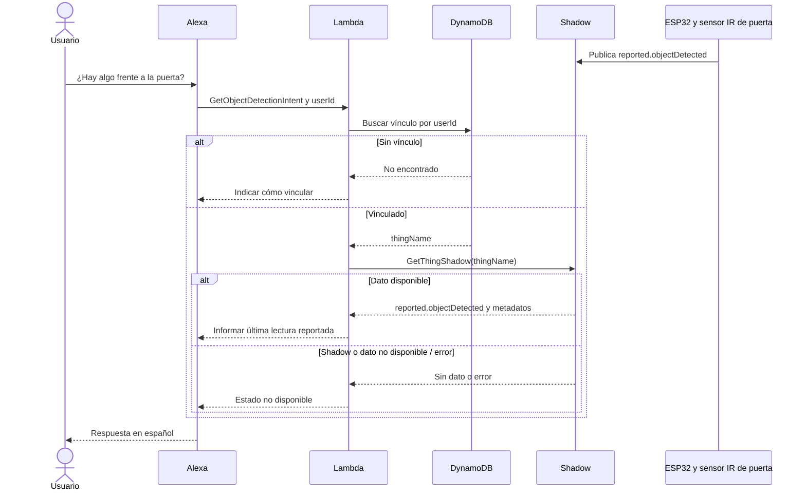
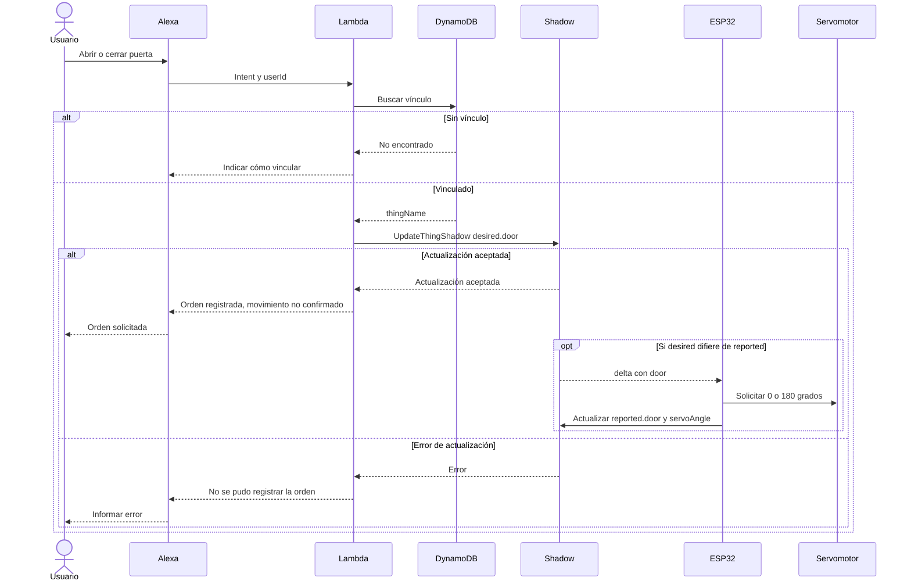

# Informe técnico: Puerta Inteligente para Mascotas

Documento inicial; las secciones pendientes se completarán durante el desarrollo y con evidencias reales. La referencia principal es [Práctica_3.md](../Práctica_3.md).

## 1. Caso de Uso y Requerimientos

### Caso de uso y justificación del sensor y actuador

La Puerta Inteligente para Mascotas está concebida para regular un paso para mascotas y permitir consultar si hay un objeto presente frente a él. Un sensor infrarrojo digital se eligió para proporcionar una señal binaria de detección dentro de su alcance; no identifica exclusivamente mascotas. Un servomotor posicional permite solicitar apertura a 180° y cierre a 0°. La detección no ordena movimientos. El control definitivo previsto pasa por Alexa, Lambda y Device Shadow; esas integraciones aún están pendientes.

El IR no garantiza que el paso esté libre ni constituye protección antiatrapamiento. No se prevén cierres automáticos por detección, ausencia o temporizador. El mecanismo debe ser ligero, de baja tensión y diseñado para evitar fuerza peligrosa; no se ha verificado y no debe usarse con animales. El servo no se adjunta al arrancar y el movimiento está deshabilitado por defecto. Al habilitarlo expresamente, una orden persistida puede producir movimiento en la conexión o reconexión; utilizar exclusivamente con el mecanismo desacoplado y sin mascotas.

### Requerimientos funcionales

Los siguientes requisitos son objetivos del sistema; las clases locales de lectura y control se han validado funcionalmente según confirmación del usuario, mientras que las integraciones de nube siguen pendientes:

| Requisito | Aplicación a la puerta para mascotas |
|---|---|
| RF1 | Leer presencia de objetos mediante el sensor IR. |
| RF2 | Reportar periódicamente detección disponible y última orden de puerta y ángulo en `reported`. |
| RF3 | Recibir diferencias `delta`, solicitar la posición y reportar la orden aplicada. |
| RF4 | Consultar en español la última detección disponible del Thing vinculado. |
| RF5 | Solicitar apertura o cierre por Alexa mediante `desired.door`. |
| RF6 | Consultar la última orden de puerta reportada, sin afirmar posición física. |
| RF7 | Vincular persistentemente un usuario con su Thing. |
| RF8 | Resolver el vínculo por `userId` y orientar al usuario si falta. |
| RF9 | Validar que el Thing exista y permitir cambiar o eliminar el vínculo. |

### Requerimientos no funcionales

Pendiente de declarar valores medibles y su justificación: estabilidad, exactitud de detección frente a una referencia, tiempo de respuesta, frecuencia de reporte y reconexión con sincronización del estado deseado.

## 2. Análisis y Diseño

### Diagrama de arquitectura

**Estado:** la Fase 4 está funcionalmente validada según las pruebas manuales informadas por el usuario, incluida la recuperación de una orden pendiente tras desconexión. El usuario confirmó comunicación ESP32–AWS y aceptación de reportes del IR durante diez minutos; el fragmento serial no muestra errores ni reinicios, pero falta el registro íntegro para demostrar ausencia de desconexiones durante todo el intervalo. Anteriormente observó errores `-4` y reconexiones. Esta validación no acredita seguridad para operación desatendida. Lambda y Alexa siguen sin implementar.



El usuario interactúa con la skill; Lambda resuelve su vínculo en DynamoDB, valida Things en IoT Core y consulta o actualiza su Shadow. El ESP32 usará MQTT sobre TLS para recibir diferencias y publicar lecturas y órdenes aplicadas. El IR aporta presencia y el servo mueve la puerta. Alexa no se comunica directamente con el ESP32; cada usuario se resuelve a su propio Thing.

### Diagrama de circuito

Conexiones propuestas, sujetas a la comprobación de los componentes reales:



El sistema recibe alimentación únicamente por USB al ESP32 DOIT DevKit V1; el sensor recibe 3.3 V de la placa y el servo se conecta a su pin 5V/VIN, con tierra común. Esta configuración cumple el requisito de una sola fuente. Debe confirmarse que la placa física suministra la tensión USB en ese pin, que el módulo IR admite 3.3 V y que su salida hacia GPIO 27 respeta los niveles del ESP32.

El consumo y los picos de corriente del servomotor podrían provocar caídas de tensión, reinicios o inestabilidad eléctrica. Se deben validar experimentalmente la capacidad de la alimentación USB y el funcionamiento del conjunto, con el mecanismo desacoplado y sin mascotas; no se han aportado resultados para esta configuración. El diagrama representa conexiones lógicas y no sustituye al esquema eléctrico definitivo.

### Diagramas de clases del objeto inteligente y Lambda

#### Firmware: estructura actual

`Main` representa el módulo `main.cpp`, no una clase real. La integración de red está implementada pero aún no se ha validado.



#### Lambda: propuesta futura

Los siguientes módulos son un diseño, no clases implementadas ni una obligación de usar un lenguaje específico.



`SkillHandler` recibe la solicitud y delega su procesamiento; `IntentRouter` selecciona el caso de uso. `ThingLinkService` valida la existencia del Thing en el registro de IoT Core y gestiona los vínculos mediante `ThingRepository`, único módulo propuesto para leer y escribir DynamoDB. `ShadowService` consulta y modifica el Shadow del Thing resuelto. `ResponseBuilder` construye respuestas de Alexa en español, incluidos errores.

### Diagramas de secuencia

Los siguientes flujos son propuestas futuras. El ESP32 publica el estado del sensor de forma independiente; la consulta de Alexa lee el último valor disponible y no solicita una medición instantánea al dispositivo.

#### Vinculación de un Thing



El registro de un vínculo no requiere comunicarse con el ESP32: se verifica el Thing en IoT Core. La existencia no garantiza que el usuario sea su propietario.

#### Consulta del sensor



#### Comando del actuador



La respuesta no espera el movimiento físico. Si `desired` ya coincide con `reported`, puede no generarse `delta`; una orden pendiente se recuperará al reconectar mediante lectura del Shadow. Sin realimentación, ni siquiera la posterior publicación confirma la posición física.

### Especificación del Shadow

**Configuración inicial confirmada por el usuario:** el Shadow clásico de `puerta-mascotas-01` contenía la siguiente orden deseada. Posteriormente el usuario observó publicaciones del sensor; el estado actual completo debe consultarse en AWS:

```json
{
  "state": {
    "desired": { "door": "closed" }
  }
}
```

El usuario confirma el funcionamiento local del sensor IR y observó publicaciones de sus cambios. `objectDetected` debe proceder de una lectura física válida. `reported.door` y `servoAngle` solo los publicará el firmware cuando haya solicitado realmente la posición; nunca se prellenarán manualmente. Un valor informado por software no confirma el ángulo físico. Se observó la recepción de `closed`, sin que ello confirme movimiento físico.

| Atributo | Ubicación | Tipo | Valores válidos | Propósito |
|---|---|---|---|---|
| `door` | `desired` | cadena | `open`, `closed` | Orden solicitada por Lambda. |
| `door` | `reported` | cadena | `open`, `closed` | Última orden aplicada por el firmware; no confirma movimiento físico. |
| `servoAngle` | `reported` | entero | `0`, `180` | Ángulo solicitado correspondiente a `closed` o `open`. |
| `objectDetected` | `reported` | booleano | `true`, `false` | Última detección leída por el ESP32. |
| `door` | `delta.state` | cadena | `open`, `closed` | Diferencia generada por el servicio cuando el valor deseado difiere del reportado. |

`desired` conserva el objetivo de control; `reported` conserva la última información publicada por el dispositivo. AWS genera `delta` a partir de sus diferencias: no es un tercer estado que se escriba manualmente. El sensor se consulta desde `reported` porque procede del entorno; el servo se solicita mediante `desired` para desacoplar la orden de la aplicación. No se propone `lastUpdate` propio hasta definir una fuente de tiempo confiable; los metadatos del Shadow podrán ayudar a evaluar antigüedad. Si falta un campo o está desactualizado según una política aún por definir, la skill debe indicar que el dato no está disponible o puede ser antiguo.

Se prevé reportar cambios de presencia por evento y periódicamente como respaldo, y reportar inmediatamente una nueva orden aplicada; los intervalos y límites de antigüedad quedan por definir, justificar y verificar. Al reconectar, el ESP32 deberá consultar el Shadow completo y aplicar el `desired` pendiente, sin depender exclusivamente de haber recibido un `delta` durante la desconexión.

### Mecanismo de vinculación

**Diseño futuro:** se propone usar directamente el `thingName` como identificador de vinculación. El nombre debe respetar el formato aceptado por IoT Core y ser recuperable de forma inequívoca del slot; la conversión de voz a identificador exacto necesita diseño y verificación. No se establece una transformación que pueda alterar guiones o números. Si Alexa no obtiene un identificador inequívoco se solicitará repetirlo o confirmarlo.

Tabla propuesta `UserThingLinks`, un registro por usuario:

| Atributo | Tipo DynamoDB | Propósito |
|---|---|---|
| `userId` | String, clave de partición | Identificador estable recibido en `context.System.user.userId`. |
| `thingName` | String | Nombre del Thing asociado. |
| `linkedAt` | String | Fecha y hora UTC ISO 8601 del registro o reemplazo. |

Para vincular, Lambda comprueba que la solicitud provenga de Alexa y contenga un `userId`, valida que el identificador no esté vacío y consulta la existencia mediante `DescribeThing`. Solo tras una respuesta positiva escribe el registro; errores de AWS no se interpretan como inexistencia. Para cambiar el vínculo, repite las validaciones antes de reemplazar el registro; si fallan, conserva el anterior. Para desvincular, elimina el registro del usuario y comunica el resultado. Ante una consulta o comando sin vínculo, indica cómo vincular el dispositivo. La identidad proviene de Alexa y no de un slot; la validación de solicitud y autorización se concretará en la implementación.

El `thingName` por sí solo no demuestra propiedad ni impide que otro usuario lo adivine; tampoco se garantiza exclusividad entre usuarios. Un código no predecible y un mecanismo de autorización son mejoras pendientes para un entorno real. Account Linking OAuth no es exigido por la guía.

### Diseño de la skill de Alexa

**Modelo propuesto, aún no configurado:** skill «Puerta Inteligente para Mascotas», invocación sugerida «puerta mascotas», idioma español; disponibilidad regional y validación del nombre quedan pendientes. Ejemplo de apertura de sesión: «Alexa, abre puerta mascotas». Las demás frases se pronuncian dentro de la skill.

| Intent | Función | Slot | Ejemplo |
|---|---|---|---|
| `OpenDoorIntent` | Solicitar apertura. | — | «abre la puerta» |
| `CloseDoorIntent` | Solicitar cierre. | — | «cierra la puerta» |
| `GetDoorStateIntent` | Consultar la última posición ordenada reportada. | — | «¿la puerta está abierta?» |
| `GetObjectDetectionIntent` | Consultar la última detección reportada. | — | «¿hay algo frente a la puerta?» |
| `LinkThingIntent` | Registrar vínculo. | `thingIdentifier` | «vincula mi puerta con el dispositivo puerta mascotas cero uno» |
| `ChangeThingLinkIntent` | Validar y reemplazar vínculo. | `thingIdentifier` | «cambia mi dispositivo a patio dos» |
| `UnlinkThingIntent` | Eliminar vínculo. | — | «desvincula mi dispositivo» |
| `AMAZON.HelpIntent` | Explicar acciones disponibles. | — | «ayuda» |
| `AMAZON.CancelIntent` | Cancelar la interacción. | — | «cancela» |
| `AMAZON.StopIntent` | Terminar la sesión. | — | «para» |
| `AMAZON.FallbackIntent` | Gestionar una solicitud no reconocida. | — | Sin frase personalizada propuesta. |

`thingIdentifier` representa el `thingName`. Su tipo de slot y estrategia de reconocimiento se definirán al implementar el modelo; las frases exactas y el reconocimiento de identificadores deberán verificarse en Alexa Developer Console. La skill debe solicitar el dato si falta y expresar que la apertura o cierre es una solicitud; la consulta de estado describe la última orden reportada, no una medición física.

## 3. Desarrollo e Implementación

### Configuración inicial de PlatformIO

Se adoptó como configuración de trabajo el entorno `esp32doit-devkit-v1`, con `espressif32@7.0.1`, framework Arduino y velocidad de monitor serie de 115200 baudios en [platformio.ini](../platformio.ini). Esta configuración proviene de proyectos anteriores; su compatibilidad con la placa física queda pendiente de verificación.

### Estructura del código y fragmentos clave

Se implementaron [SensorIR](../include/SensorIR.h) ([implementación](../src/SensorIR.cpp)) y [ControlServo](../include/ControlServo.h) ([implementación](../src/ControlServo.cpp)). `SensorIR` configura una entrada digital y su polaridad en el constructor; `iniciar()` configura el pin y realiza una primera lectura, `leer()` actualiza y devuelve la detección y `ultimoEstado()` consulta la última lectura. El programa selecciona GPIO 27 y polaridad activa en `LOW`, modificable a `HIGH` según el módulo. La lectura solo se actualiza al iniciar o al llamar a `leer()`.

`ControlServo` recibe GPIO 18 desde el programa principal y ofrece `abrir()`, `cerrar()`, `posicionSolicitada()` y `estaAbierta()`. Su inicialización se aplaza hasta recibir una orden válida y estar habilitado el movimiento; recibe la posición inicial solicitada. El estado representa exclusivamente la orden enviada: no hay retroalimentación física. La inicialización y el comportamiento de la biblioteca al adjuntar el servo deben verificarse con el mecanismo desacoplado.

La biblioteca `madhephaestus/ESP32Servo@3.0.5` se declara en [platformio.ini](../platformio.ini). El usuario confirmó el funcionamiento del firmware local de la Fase 2; la versión modificada de Fase 4 no se ha validado. [main.cpp](../src/main.cpp) integra las clases y [ShadowManager](../src/ShadowManager.cpp); el monitor serial a 115200 proporciona diagnóstico, sin comandos locales de movimiento.

#### Firmware MQTT y sincronización

`ShadowManager` coordina WiFi, `WiFiClientSecure`, PubSubClient 2.8 y ArduinoJson 6.21.5. Utiliza SSID, contraseña, endpoint y opciones desde `include/config.h`, y CA, certificado y clave desde `include/secrets.h`. Ambos son locales e ignorados; sus plantillas no contienen secretos. El cliente usa la CA para verificar el servidor y presenta certificado y clave X.509 para autenticarse. Solicita hora mediante NTP antes de validar el servidor TLS y usa puerto 8883. La conexión MQTT usa el Thing como client ID.

Según los registros aportados por el usuario, hubo errores intermitentes `MQTT_CONNECTION_TIMEOUT (-4)`. En [PubSubClient 2.8](https://github.com/knolleary/pubsubclient/blob/v2.8/src/PubSubClient.cpp), ese estado puede indicar espera agotada de la respuesta MQTT de conexión o del ping de mantenimiento; el código por sí solo no identifica la causa concreta. Se cambió `setSocketTimeout` de 3 a 15 s para la espera de lectura y respuesta MQTT, y se fijó `setKeepAlive(30)` segundos. El primer ajuste no establece el plazo de conexión TCP ni el de negociación TLS, que dependen del cliente de red. Esos procesos y las lecturas parciales aún pueden bloquear temporalmente; se requiere medición manual. Los reintentos WiFi y MQTT se mantienen separados por al menos 10 s y `mqtt.loop()` se llama en cada iteración conectada.

MQTT.fx se utiliza como cliente externo para diagnóstico manual mediante el endpoint ATS, TLS mutuo y archivos PEM locales. Debe utilizar un client ID distinto y una política que autorice explícitamente dicho ID y los tópicos de consulta, actualización y respuestas. La política mínima de ejemplo del ESP32 no autoriza por sí sola al cliente de diagnóstico. Para producción se recomienda identidad y política independientes. El usuario confirmó la consulta de `reported.objectDetected` mediante MQTT.fx; el procedimiento completo está en el [README](../README.md#diagnóstico-manual-previsto-con-mqttfx).

Tras conectar, solicita cinco suscripciones exactas y luego un `get`; si no recibe respuesta, reintenta a los 10 s. PubSubClient informa si envió la solicitud de suscripción, no confirma por sí mismo la aceptación SUBACK. La respuesta `get/accepted` permite procesar `desired.door`; `update/delta` procesa diferencias posteriores. Se valida JSON, tipo, valor y versión; se conservan las versiones durante la reconexión de la misma ejecución y se ignoran versiones anteriores. Si llega un delta durante la consulta inicial, se vuelve a consultar antes de aplicar el estado. Se rechazan órdenes distintas de `open` y `closed`. Un `get/rejected` 404 permite comenzar con lecturas reales sin asumir un comando. La recuperación evita repetir una orden igual a la última solicitada en la misma ejecución. Reiniciar pierde el estado y la versión en memoria; el restablecimiento del Shadow también requiere atención manual.

El sensor se lee cada 200 ms; se envía un reporte por cambio, limitado a uno por segundo, y otro cada 30 s como respaldo. Esto intenta reflejar eventos discretos con rapidez y moderar tráfico; ruido, coste e intervalos efectivos quedan por validar. Si la puerta aún no recibió una orden habilitada, el reporte omite `door` y `servoAngle`. Cada reporte incluye `clientToken`: el envío MQTT solo inicia la espera y la respuesta `update/accepted` correspondiente confirma su aceptación por AWS. Si llega `update/rejected`, no llega respuesta en 15 s o se pierde la conexión, se marca el estado para reenvío; los cambios ocurridos durante la espera se mantienen pendientes. No hay cola persistente ni garantía de conservar todos los cambios intermedios: se reenvía el último estado conocido.

El usuario confirmó posteriormente reportes periódicos aproximadamente cada 30 segundos y actualizaciones por cambio de detección sin esperar al siguiente reporte periódico, sujetas a los límites del firmware. El reporte por evento responde a la naturaleza discreta de la presencia; el respaldo periódico permite actualizar el estado aunque no cambie. La combinación, junto con el límite entre envíos, procura reducir mensajes idénticos innecesarios y el consumo de mensajes de AWS. No se ha proporcionado una medición exacta de latencia ni del consumo.

El buffer MQTT se mantiene en 6656 bytes, con límite de JSON entrante de 6144 bytes y documento de análisis de 8192 bytes. Es suficiente para el documento pequeño previsto, pero no garantiza admitir cualquier Shadow con metadatos o atributos adicionales; PubSubClient puede descartar paquetes mayores antes de invocar el callback. La memoria disponible y el tamaño real deben verificarse en el dispositivo.

#### Diagnóstico de publicación y desconexión

El usuario confirmó conexión WiFi y MQTT/TLS, recepción de `get/accepted` y de `desired.door = closed`, lectura física del IR y movimiento deshabilitado. Observó desconexiones MQTT `-3` tras «Reporte enviado», diez respuestas `get/accepted` en MQTT.fx, ninguna `update/accepted` ni `update/rejected`, y ausencia de `reported.objectDetected` en el Shadow. Estas observaciones no demuestran por sí solas la causa de todas las desconexiones; `-3` indica que PubSubClient detectó la pérdida de la conexión subyacente.

Se identificó un defecto concreto en la publicación: `publish(topic, salida, n)`, con `salida` de tipo `char*`, seleccionaba en PubSubClient 2.8 la sobrecarga cuyo tercer argumento es `bool retained`. La longitud no nula activaba `RETAIN`. [AWS IoT no permite publicar mensajes retenidos en tópicos reservados](https://docs.aws.amazon.com/iot/latest/developerguide/mqtt.html), y advierte que operaciones no admitidas en ellos pueden terminar la conexión. Este defecto es una explicación compatible con los síntomas, pendiente de confirmación física; no se ha demostrado que sea la única causa.

Se cambió la llamada a la sobrecarga explícita de bytes, longitud y `retained = false`. Con `THING_NAME = puerta-mascotas-01`, el tópico construido es `$aws/things/puerta-mascotas-01/shadow/update`. El JSON contiene `state.reported.objectDetected` booleano y `clientToken`; `door` y `servoAngle` solo se incluyen si existe una posición solicitada. El buffer MQTT de 6656 bytes es amplio para este reporte, cuyo buffer serializado es de 256 bytes; no se ha medido el uso real de memoria. El resultado booleano de `publish` se registra como envío local o fallo y solo el `update/accepted` con el token propio confirma aceptación. Los reportes no confirmados se reintentan de forma controlada, con el último estado disponible.

El cliente ESP32 usa `THING_NAME` como client ID, cuyo ejemplo es `puerta-mascotas-01`; el usuario indicó que MQTT.fx usa `mqttfx-puerta-mascotas-01`. Son distintos si la configuración local conserva ese Thing; no se inspeccionó el archivo local. El firmware solicita un `get` por conexión, lo reintenta si no recibe respuesta y puede solicitar otro si llega un delta durante la sincronización; múltiples `get/accepted` no demuestran por sí solos consultas duplicadas en una misma conexión. `mqtt.loop()` se ejecuta en cada iteración conectada, aunque TCP/TLS y lecturas MQTT pueden bloquear temporalmente. Se mantienen TLS, certificados, política, intervalos y movimiento deshabilitado en la plantilla. La corrección y la estabilidad aún esperan pruebas manuales.

`ENABLE_DOOR_MOVEMENT` es `false` en la plantilla. Mientras esté deshabilitado, el firmware reconoce pero no ejecuta órdenes ni publica una posición ficticia. Habilitarlo deliberadamente permite aplicar `desired`, incluso uno antiguo pendiente tras reconectar. La solución de laboratorio no distingue una orden obsoleta de una reciente y no es segura para operar cerca de mascotas; tampoco se garantiza la posición física. El usuario confirmó comunicación y aceptación de reportes; la estabilidad continua y los cambios posteriores de diagnóstico aún están pendientes de validación.

#### Diagnóstico de reconexiones

El usuario confirmó que AWS acepta los reportes del IR. También observó errores iniciales `-4`, intentos posteriores de conexión y varias sesiones en AWS para `puerta-mascotas-01`. Estos datos no permiten determinar por sí solos la causa ni demostrar sesiones simultáneas o un client ID duplicado. Se conserva el identificador existente.

El firmware registra los cambios de `WiFi.status()`, las conexiones y desconexiones MQTT con `millis()`, `mqtt.state()` y, cuando hay WiFi, RSSI. El valor de `millis()` representa tiempo desde el arranque, no hora real; tras reinicio vuelve a comenzar. La desconexión se registra una sola vez por transición detectada. Se conserva `mqtt.loop()` en cada iteración conectada, aunque las operaciones de conexión y las lecturas de red pueden bloquear temporalmente. El reintento MQTT sigue separado por 10 s y ahora se mide desde que termina cada intento, evitando reintentos inmediatos después de un intento lento.

Se mantiene un `get` al establecer la sesión y un reintento tras 10 s sin sincronización. Si un delta durante la sincronización exige otra consulta, esta se difiere hasta terminar el callback MQTT; no implica reconectar. Los múltiples `get` pueden corresponder a sesiones distintas o a estas recuperaciones y deben correlacionarse con los nuevos registros. Las suscripciones siguen informándose como solicitadas, no como confirmadas. No se modificaron la lectura del sensor, el control del servo ni la confirmación `update/accepted`; la prueba continua de estos cambios queda pendiente.

Quedan pendientes la verificación del modelo y polaridad del sensor, su alimentación y niveles de señal, la compatibilidad física de la placa, y el recorrido seguro real del servo: 0° y 180° son posiciones solicitadas y no garantizan que el mecanismo pueda alcanzarlas sin forzarse. También están pendientes las configuraciones y conexiones físicas definitivas.

### Configuración de AWS

AWS IoT Core es el servicio utilizado para registrar el dispositivo y mantener el Shadow clásico; la autenticación X.509 y el intercambio MQTT sobre TLS con el ESP32 están previstos. Según confirmación del usuario, la región es `us-east-2` (Ohio), el Thing es `puerta-mascotas-01` y el Shadow clásico contiene `desired.door = closed`, sin estado reportado por el ESP32. El client ID propuesto para el firmware es `puerta-mascotas-01`; este dispositivo inicial no limita el diseño multiusuario a un único Thing.

El usuario confirma que generó y descargó un certificado X.509, que está activo y asociado al Thing, y que la política `PuertaMascotasIoTPolicy` está asociada al certificado. La política real tiene permisos amplios por indicación del docente para el entorno académico; no se ha proporcionado su documento, por lo que no se atribuyen acciones o recursos concretos. Los permisos amplios pueden permitir acceso indebido a clientes o tópicos ajenos y ampliar el impacto de una clave comprometida.

Para producción se propone mínimo privilegio mediante la [política de ejemplo](../aws/iot-policy.example.json): `iot:Connect` al client ID exacto, `iot:Publish` solo a `get` y `update`, `iot:Subscribe` a los cinco filtros de respuesta y `iot:Receive` a sus tópicos correspondientes, usando ARN `client`, `topicfilter` y `topic`. La plantilla no representa ni modifica la política académica real. Debe adaptarse a la región y cuenta antes de su uso. El permiso de publicar en `update` no restringe campos JSON; el firmware debe limitarse a `reported`. La [guía de AWS](../aws/README.md) detalla los recursos y tópicos.

El usuario localizó el endpoint de datos ATS, cuyo sufijo es `-ats.iot.us-east-2.amazonaws.com`; se usa MQTT sobre TLS en el puerto `8883`. El certificado y la clave privada deben conservarse fuera del repositorio. El usuario confirmó una conexión y consulta del Shadow, junto con errores intermitentes; falta validar la estabilidad y los cambios posteriores. Las configuraciones de Lambda, DynamoDB y el rol IAM siguen pendientes.

#### Tópicos y sincronización previstos

Para `puerta-mascotas-01`, el prefijo es `$aws/things/puerta-mascotas-01/shadow/`:

| Sufijo | Operación prevista del ESP32 | Uso |
|---|---|---|
| `get` | Publicar | Solicitar el documento actual. |
| `get/accepted` | Suscribirse y recibir | Leer el estado para sincronizar. |
| `get/rejected` | Suscribirse y recibir | Gestionar errores, incluido Shadow inexistente. |
| `update` | Publicar | Enviar `reported` disponible. |
| `update/delta` | Suscribirse y recibir | Recibir cambios deseados pendientes. |
| `update/accepted` | Suscribirse y recibir | Recibir aceptación de una actualización. |
| `update/rejected` | Suscribirse y recibir | Recibir errores de actualización. |

En la Fase 4 el usuario observó conexión, consulta, recepción de `closed` y aceptación por AWS de reportes del sensor, además de errores iniciales y reconexiones ocasionales. Los nuevos registros de diagnóstico aún no se han validado. La aceptación del Shadow no confirma un movimiento físico.

### Configuración de Alexa

Pendiente: modelo de interacción y vinculación con Lambda.

## 4. Pruebas y Validaciones

### Validación funcional local del hardware — Fase 2

Según la confirmación del usuario, las pruebas físicas locales fueron satisfactorias: el ESP32 ejecuta el firmware desarrollado con PlatformIO, el sensor IR funciona físicamente y el servomotor responde a los comandos locales de apertura y cierre. Las clases `SensorIR` y `ControlServo` están integradas en el programa principal.

Esta validación de Fase 2 se limitó al hardware y a los comandos locales. Posteriormente, según el usuario, el ESP32 se conectó a AWS, consultó el Shadow, recibió `closed` y AWS confirmó los reportes del IR; también se habían observado errores iniciales `-4` y reconexiones ocasionales. No se ha confirmado la integración con Alexa ni se proporcionaron mediciones de latencia, exactitud, ciclos o tensiones.

### Comunicación y operación observada — Fase 4

El usuario informa una prueba manual de funcionamiento continuo durante **10 minutos**. Durante el período declarado, observó el ESP32 conectado a WiFi y AWS IoT Core mediante MQTT/TLS, lecturas del IR alternando entre detectado y no detectado, publicaciones del estado al Device Shadow y confirmaciones repetidas `Reporte propio aceptado por Shadow`. También confirmó que MQTT.fx permite consultar `reported.objectDetected`. El movimiento del servomotor permaneció deshabilitado por configuración.

El resultado es **satisfactorio para la comunicación del sensor y la operación observada durante el período declarado**, según la información proporcionada. En el fragmento serial compartido no aparecen errores MQTT ni reinicios; no se dispone del registro íntegro con marcas temporales para demostrar ausencia absoluta de desconexiones durante todo el intervalo. No se proporcionaron mediciones de latencia, exactitud ni consumo. La prueba no valida el control físico del servomotor desde AWS: la aceptación de un reporte no confirma movimiento ni posición física.

La validación posterior del actuador y de la recuperación tras desconexión se documenta por separado a continuación. Una orden persistida puede ejecutarse si se habilita el movimiento.

### Reportes periódicos y por evento — RF1 y RF2

El usuario confirmó manualmente que el ESP32 lee el sensor IR y publica su estado mediante MQTT/TLS; AWS acepta las actualizaciones en `shadow/update/accepted`. El reporte periódico se observó aproximadamente cada 30 segundos y los cambios de detección generaron una actualización sin esperar al siguiente reporte periódico, respetando las limitaciones del firmware.

| Evidencia proporcionada | `objectDetected` | `door` | `servoAngle` | Resultado |
|---|---|---|---|---|
| Captura del Shadow, versión 129 | `true` | `open` | `180` | Actualización aceptada por AWS. |
| Captura del Shadow, versión 136 | `false` | `open` | `180` | Actualización aceptada por AWS. |

Estas observaciones respaldan **RF1**, respecto a la lectura del sensor, y **RF2**, respecto al reporte del sensor y del estado lógico del actuador en `reported`. `door` representa el estado lógico y `servoAngle` la posición ordenada por el firmware; ninguno constituye una medición física independiente del ángulo. Las capturas no establecen una latencia exacta ni verifican por sí solas el control físico del servo desde AWS.

### Validación del actuador mediante AWS — RF3

El usuario confirmó manualmente que el servomotor respondió físicamente a órdenes `open` y `closed` transmitidas mediante AWS IoT Core y Device Shadow. El flujo implementado recibe por MQTT sobre TLS el estado deseado del Shadow, procesa una orden válida y publica el estado lógico solicitado en `reported`.

Para el cierre se proporcionaron las siguientes evidencias:

| Evidencia | Estado registrado | Observación |
|---|---|---|
| Shadow, versión 176 | `desired.door = "closed"` | Orden deseada de cierre registrada en AWS. |
| Shadow, versión 177 | `reported.door = "closed"`, `servoAngle = 0`, `objectDetected = false` | Reporte del ESP32 aceptado por AWS. |
| Observación personal del usuario | Cierre físico | Ejecución del cierre confirmada manualmente. |

Estas evidencias respaldan RF3 para las órdenes observadas. `servoAngle` representa la posición solicitada por software; la ejecución física del cierre se confirmó mediante observación manual, sin medición independiente del ángulo. No se proporcionó un tiempo de respuesta.

### Recuperación de una orden pendiente tras desconexión

El usuario confirmó la siguiente prueba manual: con la puerta abierta, interrumpió temporalmente la conexión WiFi del ESP32 y publicó `desired.door = "closed"` mientras el dispositivo estaba desconectado. Al restablecer WiFi, el ESP32 recuperó del Device Shadow la orden pendiente y el servomotor cerró físicamente, sin volver a publicar `closed`. AWS aceptó el estado lógico de cierre reflejado en las versiones 176 y 177 descritas anteriormente.

El resultado es **satisfactorio para la recuperación de una orden pendiente después de una desconexión**, según la confirmación del usuario. El cierre físico fue observado personalmente; `reported.door` y `servoAngle` siguen siendo el estado lógico y la posición solicitada por el firmware, sin retroalimentación independiente de posición. No se proporcionaron tiempos de reconexión ni de respuesta.

La Fase 4 queda **funcionalmente validada** dentro del alcance de las pruebas informadas. Se mantienen como limitaciones las desconexiones MQTT intermitentes observadas anteriormente, la ausencia de retroalimentación física y el riesgo de ejecutar órdenes antiguas al reconectar. Estos resultados no demuestran que el sistema sea seguro para operar desatendido o cerca de mascotas.

Permanece pendiente completar el plan y las evidencias de RF1–RF9, las frases de la skill y los atributos no funcionales medibles. La prueba de reconexión confirma el caso descrito, pero no establece tiempos de recuperación ni demuestra por sí sola el cumplimiento integral de los requisitos.

## 5. Resultados

Pendiente de mediciones y análisis.

## 6. Conclusiones

Pendiente.

## 7. Recomendaciones

Pendiente.

## 8. Anexos

Pendiente: diagramas, fotografías y evidencias pertinentes.
