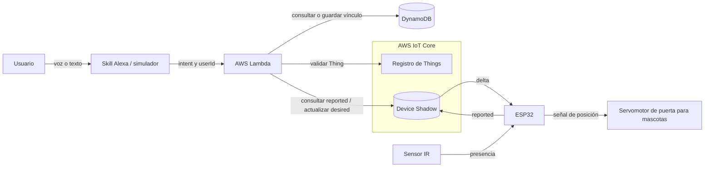
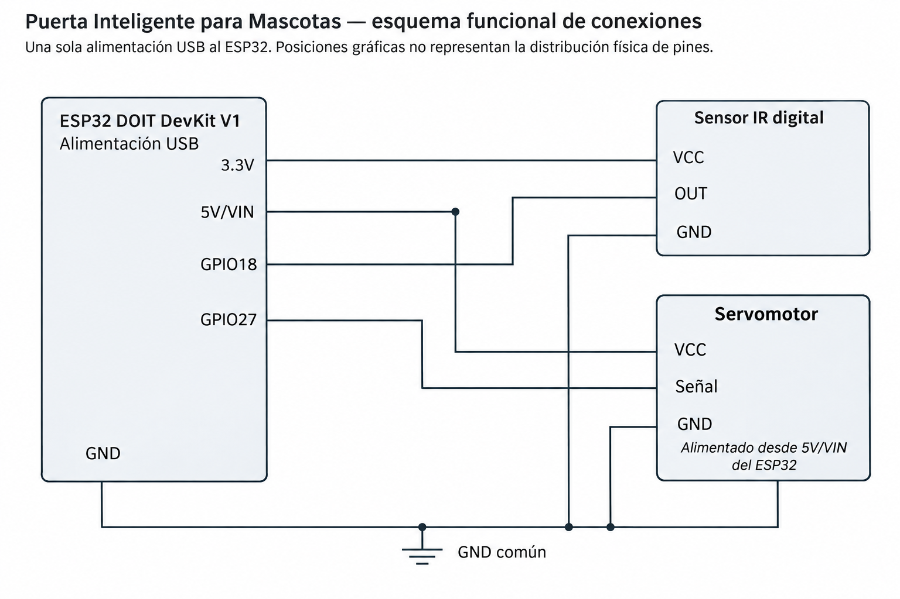
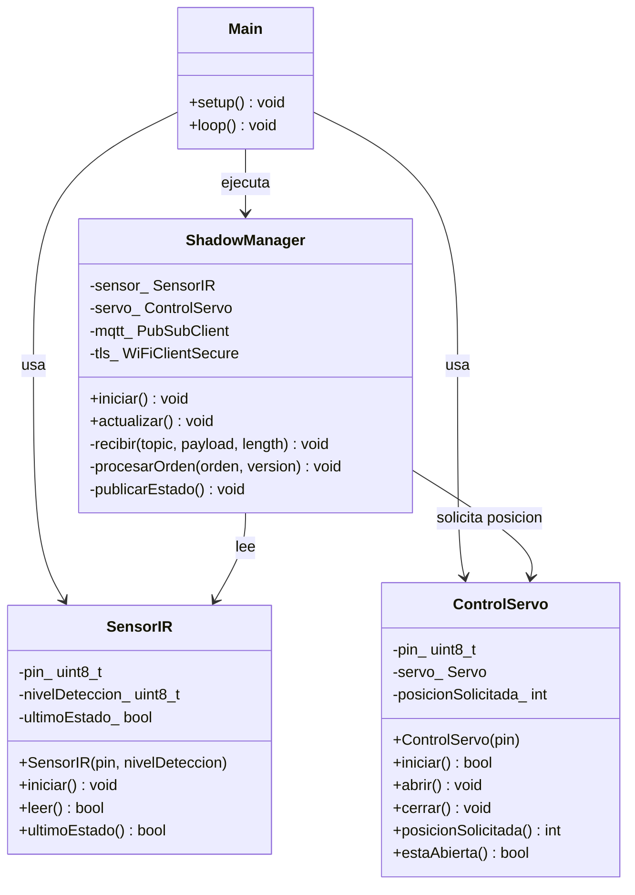
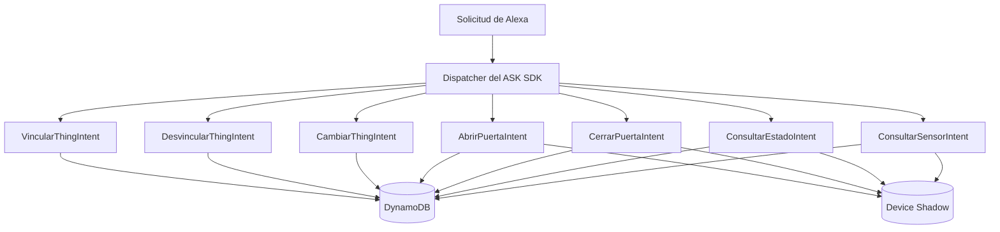
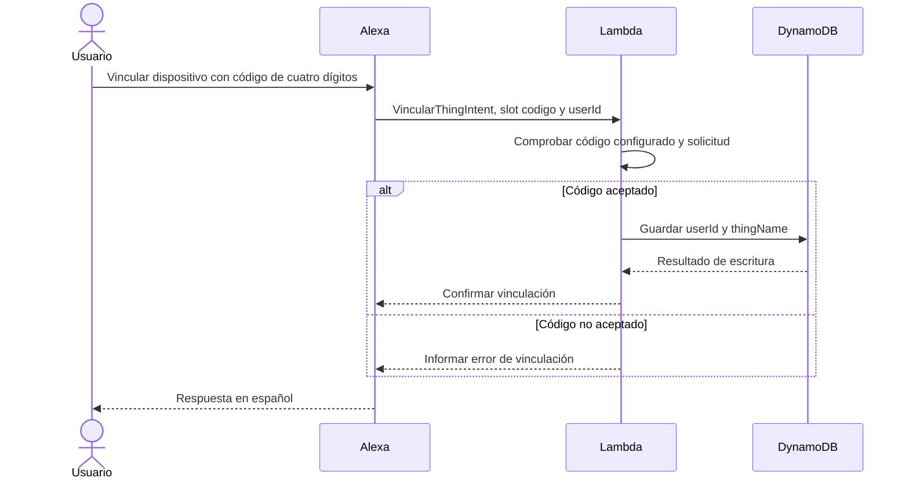
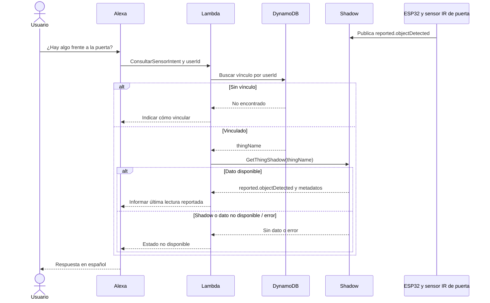
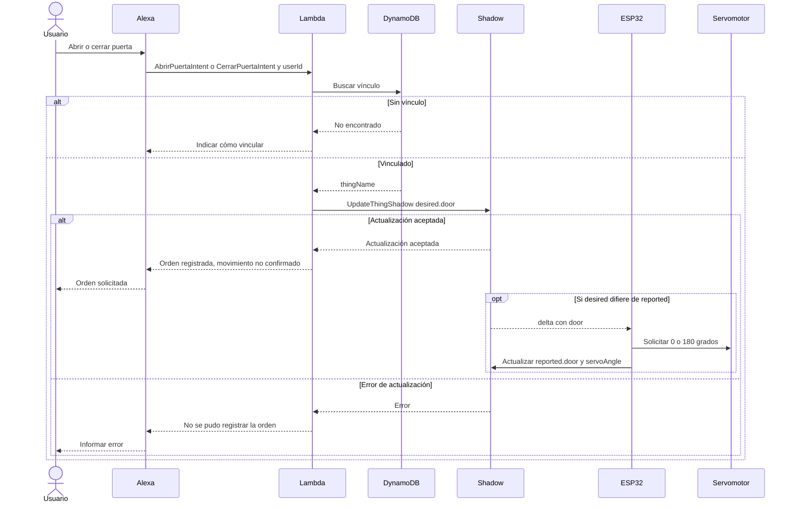

# Informe técnico: Puerta Inteligente para Mascotas

- **Práctica 3 — Documento de integración y validación**
- **Actualización:** 10 de noviembre de 2026
- **Repositorio:** [IoTPractica3](../README.md)
**Consigna:** [Práctica_3.md](../Práctica_3.md)

Este informe integra el diseño original, la implementación del firmware ESP32 y las pruebas posteriores con AWS IoT Core, Amazon DynamoDB, AWS Lambda y la Skill personalizada de Alexa. Se distinguen los resultados observados, las confirmaciones manuales del equipo y las verificaciones pendientes. Las secciones históricas de diagnóstico del firmware se conservan para documentar la evolución del proyecto.

**Estado general:** se comprobaron el intercambio de órdenes de apertura/cierre, la sincronización de Device Shadow y la consulta del sensor IR; el integrante encargado del hardware confirmó el movimiento físico del SG90. No se afirma seguridad para el uso autónomo con animales, precisión del ángulo ni métricas de latencia no medidas.

## 1. Caso de Uso y Requerimientos

### Caso de uso y justificación del sensor y actuador

La Puerta Inteligente para Mascotas está concebida para regular un paso para mascotas y permitir consultar si hay un objeto presente frente a él. Un sensor infrarrojo digital se eligió para proporcionar una señal binaria de detección dentro de su alcance; no identifica exclusivamente mascotas. Un servomotor posicional permite solicitar apertura a 180° y cierre a 0°. La detección no ordena movimientos. El control por Alexa, AWS Lambda y Device Shadow fue integrado y probado durante la fase final.

El IR no garantiza que el paso esté libre ni constituye protección antiatrapamiento. No se prevén cierres automáticos por detección, ausencia o temporizador. El mecanismo debe ser ligero, de baja tensión y diseñado para evitar fuerza peligrosa; no se ha verificado y no debe usarse con animales. La plantilla del firmware mantiene el movimiento deshabilitado por defecto. Para las pruebas finales se habilitó deliberadamente `ENABLE_DOOR_MOVEMENT = true` y se cargó el firmware al ESP32. Una orden persistida puede producir movimiento en la conexión o reconexión; las pruebas deben realizarse con la zona despejada, sin mascotas y, de preferencia, con el mecanismo desacoplado.

### Requerimientos funcionales

Los siguientes requisitos definen el alcance de la práctica. Se comprobó el funcionamiento de la mayor parte mediante pruebas de consola, Device Shadow y observación del prototipo; la sustitución por un segundo Thing y algunas validaciones exhaustivas siguen pendientes:

| Requisito | Aplicación a la puerta para mascotas |
|---|---|
| RF1 | Leer presencia de objetos mediante el sensor IR. |
| RF2 | Reportar periódicamente detección disponible y última orden de puerta y ángulo en `reported`. |
| RF3 | Recibir diferencias `delta`, solicitar la posición y reportar la orden aplicada. |
| RF4 | Consultar en español la última detección disponible del Thing vinculado. |
| RF5 | Solicitar apertura o cierre por Alexa mediante `desired.door`. |
| RF6 | Consultar la última orden de puerta reportada, sin afirmar posición física. |
| RF7 | Vincular persistentemente un usuario con su Thing. |
| RF8 | Resolver el vínculo por `userId` y orientar al usuario si falta. |
| RF9 | Validar que el Thing exista y permitir cambiar o eliminar el vínculo. |

### Requerimientos no funcionales

Se adoptaron como criterios de observación la conectividad MQTT/TLS, publicación de lecturas y cambios de estado, recuperación de órdenes pendientes y respuesta de Alexa. El firmware documenta una lectura de IR aproximadamente cada **200 ms**, una separación mínima de **1 s** entre publicaciones y un reporte de respaldo cada **30 s**; estos son parámetros implementados, no mediciones de latencia de extremo a extremo.

| Criterio | Evidencia disponible | Estado |
|---|---|---|
| Comunicación ESP32–AWS | Shadow sincronizado y reportes de IR | Comprobación funcional |
| Apertura/cierre desde Alexa | Respuestas de la Skill y confirmación física del SG90 | Comprobación funcional |
| Detección IR | Lecturas `true` y `false` en Shadow y Alexa | Comprobación funcional |
| Reconexión | Caso manual de recuperación de orden reportado en fase 4 | Caso específico comprobado; no prueba exhaustiva |
| Estabilidad | Observación de 10 minutos consignada en fase 4 | Sin registro íntegro para certificar continuidad total |
| Latencia, precisión y consumo | No se proporcionaron series de medición | Pendientes de cuantificación |

## 2. Análisis y Diseño

### Diagrama de arquitectura

La arquitectura de la fase final está integrada: Alexa recibe frases en español, AWS Lambda procesa intents, DynamoDB conserva el vínculo `userId`/`thingName`, IoT Core gestiona el Device Shadow y el ESP32 intercambia mensajes MQTT/TLS con AWS. El sensor IR informa lecturas, mientras el servomotor ejecuta órdenes de control. Las pruebas no acreditan un mecanismo de protección antiatrapamiento.



El usuario interactúa con la skill; Lambda resuelve su vínculo en DynamoDB y consulta o actualiza el Shadow del Thing asociado. El ESP32 utiliza MQTT sobre TLS para recibir diferencias y publicar lecturas y estados de órdenes. El IR aporta presencia y el servo mueve la puerta. Alexa no se comunica directamente con el ESP32; el vínculo de cada usuario se consulta de forma persistente en DynamoDB.

### Diagrama de circuito

El equipo proporcionó un esquema funcional de la alimentación USB, el ESP32 DOIT DevKit V1, el sensor IR digital y el SG90. La imagen se incorpora en las evidencias:



**Esquema de conexiones actualizado:** el equipo confirmó que la imagen entregada es la versión vigente del circuito: **IR OUT → GPIO18** y **señal del SG90 → GPIO27**. La descripción de pines del informe anterior corresponde a una versión desactualizada. Antes de dar por coincidente el código entregado, se debe revisar que `src/main.cpp` o su configuración de pines también usen estas asignaciones. La tabla documenta el esquema final proporcionado:

| Componente | Conexión del esquema actualizado | Alimentación |
|---|---|---|
| Sensor IR digital | OUT a GPIO18 | VCC a 3.3 V, GND común |
| SG90 | Señal a GPIO27 | VCC a 5V/VIN, GND común |

El esquema indica una única entrada USB al ESP32. Debe comprobarse que 5V/VIN entregue tensión apropiada con alimentación USB y que la fuente soporte los picos de corriente del servo; una alimentación insuficiente puede provocar reinicios. No deben realizarse pruebas con mascotas ni cargas peligrosas. Las posiciones dibujadas representan conectividad funcional, no localización física de los pines.

### Diagramas de clases del objeto inteligente y Lambda

#### Firmware: estructura actual

`Main` representa el módulo `main.cpp`, no una clase real. La integración WiFi/MQTT/TLS con IoT Core fue probada posteriormente. Las firmas del diagrama deben contrastarse con la versión entregada del firmware.



#### AWS Lambda: arquitectura implementada

El código real del backend está en [`lambda/lambda_function.py`](../lambda/lambda_function.py) y utiliza ASK SDK for Python y Boto3. No se conservó el diagrama de clases propuesto de `SkillHandler`, `IntentRouter` y `ThingRepository`, porque eran **clases hipotéticas** y no representaban necesariamente la implementación desplegada.



La función `puerta_mascotas_alexa` utiliza variables de entorno `TABLE_NAME`, `THING_NAME`, `PAIRING_CODE` e `IOT_ENDPOINT`. El timeout se amplió a **7 segundos** durante las pruebas. En el código real debe verificarse la implementación exacta de validaciones y manejo de excepciones; aquí se documentan los resultados ensayados, no capacidades no probadas.

### Diagramas de secuencia

Los siguientes diagramas describen los flujos integrados comprobados. El ESP32 publica lecturas del sensor de forma independiente: una consulta de Alexa recupera el último valor disponible, sin solicitar una medición instantánea.

#### Vinculación de un Thing mediante código



El sistema de prueba utilizó un código de cuatro dígitos, no el dictado del nombre completo del Thing. Se comprobó creación, eliminación y recreación de la asociación en DynamoDB. La verificación de pertenencia real del dispositivo y la rotación segura del código requerirían un esquema de autorización más fuerte para producción.

#### Consulta del sensor



#### Comando del actuador



La respuesta no espera el movimiento físico. Si `desired` ya coincide con `reported`, puede no generarse `delta`; una orden pendiente se recuperará al reconectar mediante lectura del Shadow. Sin realimentación, ni siquiera la posterior publicación confirma la posición física.

### Especificación del Shadow

En la fase inicial el Shadow solo contenía `desired.door = "closed"`. En la fase final se observaron estados `desired` y `reported` sincronizados en apertura y cierre, y valores del sensor `true` y `false`. El siguiente documento es **ilustrativo** de un estado cerrado con sensor sin detección (los valores reales varían con la lectura física):

```json
{
  "state": {
    "desired": { "door": "closed" },
    "reported": {
      "door": "closed",
      "servoAngle": 0,
      "objectDetected": false
    }
  }
}
```

Las capturas muestran también estados abiertos con `servoAngle = 180`, y un estado cerrado con `objectDetected = true`; esto demuestra que la detección del IR es independiente de la orden de puerta. El movimiento físico del servo fue confirmado visualmente por el integrante encargado del prototipo, no por un sensor de ángulo.

| Atributo | Ubicación | Tipo | Valores válidos | Propósito |
|---|---|---|---|---|
| `door` | `desired` | cadena | `open`, `closed` | Orden solicitada por Lambda. |
| `door` | `reported` | cadena | `open`, `closed` | Última orden aplicada por el firmware; no confirma movimiento físico. |
| `servoAngle` | `reported` | entero | `0`, `180` | Ángulo solicitado correspondiente a `closed` o `open`. |
| `objectDetected` | `reported` | booleano | `true`, `false` | Última detección leída por el ESP32. |
| `door` | `delta.state` | cadena | `open`, `closed` | Diferencia generada por el servicio cuando el valor deseado difiere del reportado. |

`desired` conserva el objetivo de control; `reported` conserva la última información publicada por el dispositivo. AWS genera `delta` a partir de sus diferencias: no es un tercer estado que se escriba manualmente. El sensor se consulta desde `reported` porque procede del entorno; el servo se solicita mediante `desired` para desacoplar la orden de la aplicación. No se propone `lastUpdate` propio hasta definir una fuente de tiempo confiable; los metadatos del Shadow podrán ayudar a evaluar antigüedad. Si falta un campo o está desactualizado según una política aún por definir, la skill debe indicar que el dato no está disponible o puede ser antiguo.

El firmware documenta reportes por evento y periódicos de respaldo, con lectura del sensor cada 200 ms, límite de un reporte por segundo y respaldo cada 30 s; se observaron actualizaciones por cambio y periódicas. No se midieron la latencia real ni los límites de antigüedad. Se documentó una prueba manual en la que, tras una desconexión, el ESP32 recuperó una orden pendiente desde el Shadow y ejecutó el cierre. Este caso no valida exhaustivamente todas las situaciones de reconexión.

### Mecanismo de vinculación

La tabla utilizada es **`puerta_mascotas_usuarios`**, con `userId` (String) como clave de partición y `thingName` (String) como atributo de asociación. La vinculación se crea mediante el intent `VincularThingIntent` y un código de cuatro dígitos capturado en el slot `codigo` (`AMAZON.FOUR_DIGIT_NUMBER`). La variable `THING_NAME` identifica el dispositivo de demostración `puerta-mascotas-01`; el código de vinculación se configura en Lambda mediante `PAIRING_CODE`.

Se comprobó en DynamoDB la creación del vínculo, la eliminación mediante `DesvincularThingIntent` y la vinculación posterior. `CambiarThingIntent` reconoció el caso de intento de cambio al mismo Thing ya vinculado; **no se probó** la sustitución efectiva por un segundo dispositivo. El `userId` se presenta oculto en las evidencias y no se almacena en documentos públicos.

Este esquema es suficiente para el prototipo académico, pero un código de demostración no constituye un mecanismo de propiedad del dispositivo o autorización robusta en un despliegue real. La validación detallada del código y sus controles deben cotejarse con el archivo Python final.

### Diseño y configuración de la Skill de Alexa

Se configuró la Skill personalizada **Puerta Inteligente para Mascotas**, idioma **es-MX** y nombre de invocación **«puerta de mascotas»**. El modelo real exportado se conserva en [`alexa/modelo_interaccion_es-MX.json`](../alexa/modelo_interaccion_es-MX.json).

| Intent personalizado | Función | Slot |
|---|---|---|
| `VincularThingIntent` | Crear asociación de usuario y Thing | `codigo: AMAZON.FOUR_DIGIT_NUMBER` |
| `AbrirPuertaIntent` | Solicitar `desired.door = "open"` | — |
| `CerrarPuertaIntent` | Solicitar `desired.door = "closed"` | — |
| `ConsultarEstadoIntent` | Consultar `reported.door` | — |
| `ConsultarSensorIntent` | Consultar `reported.objectDetected` | — |
| `DesvincularThingIntent` | Eliminar la asociación en DynamoDB | — |
| `CambiarThingIntent` | Solicitar cambio de vinculación | `codigo: AMAZON.FOUR_DIGIT_NUMBER` |

El modelo también contiene `AMAZON.CancelIntent`, `AMAZON.HelpIntent`, `AMAZON.StopIntent` y `AMAZON.NavigateHomeIntent`.

Frases verificadas en el simulador: «dile a puerta de mascotas que abra la puerta», «... que cierre la puerta», «... que consulte el estado de la puerta», «... que consulte el sensor» y comandos de vinculación, desvinculación y cambio. Se modificaron frases de ejemplo para resolver confusiones iniciales de reconocimiento de intents.

## 3. Desarrollo e Implementación

### Configuración inicial de PlatformIO

Se adoptó como configuración de trabajo el entorno `esp32doit-devkit-v1`, con `espressif32@7.0.1`, framework Arduino y velocidad de monitor serie de 115200 baudios en [platformio.ini](../platformio.ini). Esta configuración proviene de proyectos anteriores; su compatibilidad con la placa física queda pendiente de verificación.

### Estructura del código y fragmentos clave

Se implementaron [SensorIR](../include/SensorIR.h) ([implementación](../src/SensorIR.cpp)) y [ControlServo](../include/ControlServo.h) ([implementación](../src/ControlServo.cpp)). `SensorIR` configura una entrada digital y su polaridad en el constructor; `iniciar()` configura el pin y realiza una primera lectura, `leer()` actualiza y devuelve la detección y `ultimoEstado()` consulta la última lectura. **Según el diagrama de conexiones actualizado, la salida OUT del sensor está conectada a GPIO18**. Una versión anterior de la documentación señalaba GPIO27; por ello, debe comprobarse que las constantes de pines del firmware entregado coincidan con el diagrama final. La polaridad de detección también depende de la configuración del módulo. La lectura solo se actualiza al iniciar o al llamar a `leer()`.

**Según el esquema actualizado, el SG90 recibe la señal de control desde GPIO27**. La documentación anterior mencionaba GPIO18; antes de entregar, corresponde confirmar el pin configurado en el código y que refleje el cableado actualizado. `ControlServo` ofrece `abrir()`, `cerrar()`, `posicionSolicitada()` y `estaAbierta()`. Su inicialización se aplaza hasta recibir una orden válida y estar habilitado el movimiento; recibe la posición inicial solicitada. El estado representa exclusivamente la orden enviada: no hay retroalimentación física. La inicialización y el comportamiento de la biblioteca al adjuntar el servo deben verificarse con el mecanismo desacoplado.

La biblioteca `madhephaestus/ESP32Servo@3.0.5` se declara en [platformio.ini](../platformio.ini). Se probó el firmware local de la Fase 2 y posteriormente se comprobó la integración con AWS IoT Core y Alexa. [main.cpp](../src/main.cpp) integra las clases y [ShadowManager](../src/ShadowManager.cpp); el monitor serial a 115200 proporciona diagnóstico, sin comandos locales de movimiento.

#### Firmware MQTT y sincronización

`ShadowManager` coordina WiFi, `WiFiClientSecure`, PubSubClient 2.8 y ArduinoJson 6.21.5. Utiliza SSID, contraseña, endpoint y opciones desde `include/config.h`, y CA, certificado y clave desde `include/secrets.h`. Ambos son locales e ignorados; sus plantillas no contienen secretos. El cliente usa la CA para verificar el servidor y presenta certificado y clave X.509 para autenticarse. Solicita hora mediante NTP antes de validar el servidor TLS y usa puerto 8883. La conexión MQTT usa el Thing como client ID.

Según los registros aportados por el usuario, hubo errores intermitentes `MQTT_CONNECTION_TIMEOUT (-4)`. En [PubSubClient 2.8](https://github.com/knolleary/pubsubclient/blob/v2.8/src/PubSubClient.cpp), ese estado puede indicar espera agotada de la respuesta MQTT de conexión o del ping de mantenimiento; el código por sí solo no identifica la causa concreta. Se cambió `setSocketTimeout` de 3 a 15 s para la espera de lectura y respuesta MQTT, y se fijó `setKeepAlive(30)` segundos. El primer ajuste no establece el plazo de conexión TCP ni el de negociación TLS, que dependen del cliente de red. Esos procesos y las lecturas parciales aún pueden bloquear temporalmente; se requiere medición manual. Los reintentos WiFi y MQTT se mantienen separados por al menos 10 s y `mqtt.loop()` se llama en cada iteración conectada.

MQTT.fx se utiliza como cliente externo para diagnóstico manual mediante el endpoint ATS, TLS mutuo y archivos PEM locales. Debe utilizar un client ID distinto y una política que autorice explícitamente dicho ID y los tópicos de consulta, actualización y respuestas. La política mínima de ejemplo del ESP32 no autoriza por sí sola al cliente de diagnóstico. Para producción se recomienda identidad y política independientes. El usuario confirmó la consulta de `reported.objectDetected` mediante MQTT.fx; el procedimiento completo está en el [README](../README.md#diagnóstico-manual-previsto-con-mqttfx).

Tras conectar, solicita cinco suscripciones exactas y luego un `get`; si no recibe respuesta, reintenta a los 10 s. PubSubClient informa si envió la solicitud de suscripción, no confirma por sí mismo la aceptación SUBACK. La respuesta `get/accepted` permite procesar `desired.door`; `update/delta` procesa diferencias posteriores. Se valida JSON, tipo, valor y versión; se conservan las versiones durante la reconexión de la misma ejecución y se ignoran versiones anteriores. Si llega un delta durante la consulta inicial, se vuelve a consultar antes de aplicar el estado. Se rechazan órdenes distintas de `open` y `closed`. Un `get/rejected` 404 permite comenzar con lecturas reales sin asumir un comando. La recuperación evita repetir una orden igual a la última solicitada en la misma ejecución. Reiniciar pierde el estado y la versión en memoria; el restablecimiento del Shadow también requiere atención manual.

El sensor se lee cada 200 ms; se envía un reporte por cambio, limitado a uno por segundo, y otro cada 30 s como respaldo. Esto intenta reflejar eventos discretos con rapidez y moderar tráfico; ruido, coste e intervalos efectivos quedan por validar. Si la puerta aún no recibió una orden habilitada, el reporte omite `door` y `servoAngle`. Cada reporte incluye `clientToken`: el envío MQTT solo inicia la espera y la respuesta `update/accepted` correspondiente confirma su aceptación por AWS. Si llega `update/rejected`, no llega respuesta en 15 s o se pierde la conexión, se marca el estado para reenvío; los cambios ocurridos durante la espera se mantienen pendientes. No hay cola persistente ni garantía de conservar todos los cambios intermedios: se reenvía el último estado conocido.

El usuario confirmó posteriormente reportes periódicos aproximadamente cada 30 segundos y actualizaciones por cambio de detección sin esperar al siguiente reporte periódico, sujetas a los límites del firmware. El reporte por evento responde a la naturaleza discreta de la presencia; el respaldo periódico permite actualizar el estado aunque no cambie. La combinación, junto con el límite entre envíos, procura reducir mensajes idénticos innecesarios y el consumo de mensajes de AWS. No se ha proporcionado una medición exacta de latencia ni del consumo.

El buffer MQTT se mantiene en 6656 bytes, con límite de JSON entrante de 6144 bytes y documento de análisis de 8192 bytes. Es suficiente para el documento pequeño previsto, pero no garantiza admitir cualquier Shadow con metadatos o atributos adicionales; PubSubClient puede descartar paquetes mayores antes de invocar el callback. La memoria disponible y el tamaño real deben verificarse en el dispositivo.

#### Diagnóstico de publicación y desconexión

El usuario confirmó conexión WiFi y MQTT/TLS, recepción de `get/accepted` y de `desired.door = closed`, lectura física del IR y movimiento deshabilitado. Observó desconexiones MQTT `-3` tras «Reporte enviado», diez respuestas `get/accepted` en MQTT.fx, ninguna `update/accepted` ni `update/rejected`, y ausencia de `reported.objectDetected` en el Shadow. Estas observaciones no demuestran por sí solas la causa de todas las desconexiones; `-3` indica que PubSubClient detectó la pérdida de la conexión subyacente.

Se identificó un defecto concreto en la publicación: `publish(topic, salida, n)`, con `salida` de tipo `char*`, seleccionaba en PubSubClient 2.8 la sobrecarga cuyo tercer argumento es `bool retained`. La longitud no nula activaba `RETAIN`. [AWS IoT no permite publicar mensajes retenidos en tópicos reservados](https://docs.aws.amazon.com/iot/latest/developerguide/mqtt.html), y advierte que operaciones no admitidas en ellos pueden terminar la conexión. Este defecto es una explicación compatible con los síntomas, pendiente de confirmación física; no se ha demostrado que sea la única causa.

Se cambió la llamada a la sobrecarga explícita de bytes, longitud y `retained = false`. Con `THING_NAME = puerta-mascotas-01`, el tópico construido es `$aws/things/puerta-mascotas-01/shadow/update`. El JSON contiene `state.reported.objectDetected` booleano y `clientToken`; `door` y `servoAngle` solo se incluyen si existe una posición solicitada. El buffer MQTT de 6656 bytes es amplio para este reporte, cuyo buffer serializado es de 256 bytes; no se ha medido el uso real de memoria. El resultado booleano de `publish` se registra como envío local o fallo y solo el `update/accepted` con el token propio confirma aceptación. Los reportes no confirmados se reintentan de forma controlada, con el último estado disponible.

El cliente ESP32 usa `THING_NAME` como client ID, cuyo ejemplo es `puerta-mascotas-01`; el usuario indicó que MQTT.fx usa `mqttfx-puerta-mascotas-01`. Son distintos si la configuración local conserva ese Thing; no se inspeccionó el archivo local. El firmware solicita un `get` por conexión, lo reintenta si no recibe respuesta y puede solicitar otro si llega un delta durante la sincronización; múltiples `get/accepted` no demuestran por sí solos consultas duplicadas en una misma conexión. `mqtt.loop()` se ejecuta en cada iteración conectada, aunque TCP/TLS y lecturas MQTT pueden bloquear temporalmente. Se mantienen TLS, certificados, política, intervalos y movimiento deshabilitado en la plantilla. Posteriormente se comprobó la recepción y publicación de estados del Shadow; la estabilidad a largo plazo continúa sin cuantificación.

`ENABLE_DOOR_MOVEMENT` es `false` en la plantilla de seguridad. Para las pruebas finales con SG90 se cambió a `true` y se cargó el firmware. Habilitarlo permite aplicar `desired`, incluso una orden antigua pendiente tras reconectar; el prototipo no es seguro para operar desatendido cerca de mascotas. Se confirmó movimiento físico mediante observación, no mediante realimentación de posición. La estabilidad continua y los escenarios de desconexión siguen pendientes de un estudio exhaustivo.

#### Diagnóstico de reconexiones

El usuario confirmó que AWS acepta los reportes del IR. También observó errores iniciales `-4`, intentos posteriores de conexión y varias sesiones en AWS para `puerta-mascotas-01`. Estos datos no permiten determinar por sí solos la causa ni demostrar sesiones simultáneas o un client ID duplicado. Se conserva el identificador existente.

El firmware registra los cambios de `WiFi.status()`, las conexiones y desconexiones MQTT con `millis()`, `mqtt.state()` y, cuando hay WiFi, RSSI. El valor de `millis()` representa tiempo desde el arranque, no hora real; tras reinicio vuelve a comenzar. La desconexión se registra una sola vez por transición detectada. Se conserva `mqtt.loop()` en cada iteración conectada, aunque las operaciones de conexión y las lecturas de red pueden bloquear temporalmente. El reintento MQTT sigue separado por 10 s y ahora se mide desde que termina cada intento, evitando reintentos inmediatos después de un intento lento.

Se mantiene un `get` al establecer la sesión y un reintento tras 10 s sin sincronización. Si un delta durante la sincronización exige otra consulta, esta se difiere hasta terminar el callback MQTT; no implica reconectar. Los múltiples `get` pueden corresponder a sesiones distintas o a estas recuperaciones y deben correlacionarse con los nuevos registros. Las suscripciones siguen informándose como solicitadas, no como confirmadas. No se modificaron la lectura del sensor, el control del servo ni la confirmación `update/accepted`; la prueba continua de estos cambios queda pendiente.

Quedan pendientes la verificación del modelo y polaridad del sensor, su alimentación y niveles de señal, la compatibilidad física de la placa, y el recorrido seguro real del servo: 0° y 180° son posiciones solicitadas y no garantizan que el mecanismo pueda alcanzarlas sin forzarse. También están pendientes las configuraciones y conexiones físicas definitivas.

### Configuración de AWS

La integración se desplegó en **`us-east-2` (Ohio)**. En AWS IoT Core se registró el Thing **`puerta-mascotas-01`**, con Shadow clásico y certificado X.509 activo y asociado a la política **`PuertaMascotasIoTPolicy`**. Se utilizó el endpoint ATS de la cuenta y MQTT/TLS en el puerto **8883**.

Durante las pruebas se corrigieron los ARN de la política IoT y se comprobó su **versión 3 activa**, con permisos específicos `iot:Connect`, `iot:Publish`, `iot:Subscribe` e `iot:Receive` para los clientes y tópicos utilizados. La [plantilla de mínimo privilegio](../aws/iot-policy.example.json) es **un ejemplo**, no una exportación exacta de esa política desplegada. No se incluyen certificados privados ni contraseñas en el repositorio.

La tabla DynamoDB **`puerta_mascotas_usuarios`** almacena `userId` y `thingName`. AWS Lambda **`puerta_mascotas_alexa`** utiliza Boto3, las variables `TABLE_NAME`, `THING_NAME`, `PAIRING_CODE` e `IOT_ENDPOINT`, y el rol **`PuertaMascotasLambdaRole`** con permisos para sus operaciones. Se utilizó CloudWatch para diagnosticar problemas. El tiempo de espera de la función se incrementó a **7 s**. El endpoint incorrecto y algunos conflictos del modelo de voz se corrigieron antes de las pruebas finales.

La arquitectura completa, recursos y consideraciones de seguridad están detallados en [`aws/README.md`](../aws/README.md), [`lambda/README.md`](../lambda/README.md) y [`alexa/README.md`](../alexa/README.md).

#### Tópicos y sincronización utilizados

Para `puerta-mascotas-01`, el prefijo es `$aws/things/puerta-mascotas-01/shadow/`:

| Sufijo | Operación prevista del ESP32 | Uso |
|---|---|---|
| `get` | Publicar | Solicitar el documento actual. |
| `get/accepted` | Suscribirse y recibir | Leer el estado para sincronizar. |
| `get/rejected` | Suscribirse y recibir | Gestionar errores, incluido Shadow inexistente. |
| `update` | Publicar | Enviar `reported` disponible. |
| `update/delta` | Suscribirse y recibir | Recibir cambios deseados pendientes. |
| `update/accepted` | Suscribirse y recibir | Recibir aceptación de una actualización. |
| `update/rejected` | Suscribirse y recibir | Recibir errores de actualización. |

En la Fase 4 se comprobó conexión, consulta del Shadow, recepción de órdenes y aceptación de reportes del sensor. En las pruebas finales se observaron estados `open` y `closed` sincronizados y se confirmó visualmente el giro del SG90. La aceptación del Shadow, por sí sola, no mide el movimiento físico.

### Configuración de Alexa

La Skill se configuró y probó con **es-MX**, nombre de invocación **«puerta de mascotas»**, siete intents personalizados y dos slots `codigo` (`AMAZON.FOUR_DIGIT_NUMBER`). Se enlazó la Skill con AWS Lambda `puerta_mascotas_alexa` y se verificaron sus respuestas mediante Alexa Developer Console. El modelo exportado está en [`alexa/modelo_interaccion_es-MX.json`](../alexa/modelo_interaccion_es-MX.json).

## 4. Pruebas y Validaciones

### Validación funcional local del hardware — Fase 2

Según la confirmación del usuario, las pruebas físicas locales fueron satisfactorias: el ESP32 ejecuta el firmware desarrollado con PlatformIO, el sensor IR funciona físicamente y el servomotor responde a los comandos locales de apertura y cierre. Las clases `SensorIR` y `ControlServo` están integradas en el programa principal.

Esta validación de Fase 2 se limitó al hardware y a los comandos locales. Posteriormente, según el usuario, el ESP32 se conectó a AWS, consultó el Shadow, recibió `closed` y AWS confirmó los reportes del IR; también se habían observado errores iniciales `-4` y reconexiones ocasionales. Posteriormente se confirmó la integración con Alexa y el movimiento físico al enviar órdenes desde la Skill; no se aportaron mediciones de latencia, exactitud, ciclos o tensiones.

### Comunicación y operación observada — Fase 4

El usuario informa una prueba manual de funcionamiento continuo durante **10 minutos**. Durante el período declarado, observó el ESP32 conectado a WiFi y AWS IoT Core mediante MQTT/TLS, lecturas del IR alternando entre detectado y no detectado, publicaciones del estado al Device Shadow y confirmaciones repetidas `Reporte propio aceptado por Shadow`. También confirmó que MQTT.fx permite consultar `reported.objectDetected`. Durante **esta prueba inicial de comunicación** el movimiento del servomotor estaba deshabilitado; en la prueba posterior de extremo a extremo se habilitó y se confirmó su movimiento físico.

El resultado es **satisfactorio para la comunicación del sensor y la operación observada durante el período declarado**, según la información proporcionada. En el fragmento serial compartido no aparecen errores MQTT ni reinicios; no se dispone del registro íntegro con marcas temporales para demostrar ausencia absoluta de desconexiones durante todo el intervalo. No se proporcionaron mediciones de latencia, exactitud ni consumo. Esta prueba inicial no validaba por sí misma el movimiento físico; la prueba posterior de apertura/cierre desde Alexa sí incluyó confirmación visual del SG90.

La validación posterior del actuador y de la recuperación tras desconexión se documenta por separado a continuación. Una orden persistida puede ejecutarse si se habilita el movimiento.

### Reportes periódicos y por evento — RF1 y RF2

El usuario confirmó manualmente que el ESP32 lee el sensor IR y publica su estado mediante MQTT/TLS; AWS acepta las actualizaciones en `shadow/update/accepted`. El reporte periódico se observó aproximadamente cada 30 segundos y los cambios de detección generaron una actualización sin esperar al siguiente reporte periódico, respetando las limitaciones del firmware.

| Evidencia proporcionada | `objectDetected` | `door` | `servoAngle` | Resultado |
|---|---|---|---|---|
| Captura del Shadow, versión 129 | `true` | `open` | `180` | Actualización aceptada por AWS. |
| Captura del Shadow, versión 136 | `false` | `open` | `180` | Actualización aceptada por AWS. |

Estas observaciones respaldan **RF1**, respecto a la lectura del sensor, y **RF2**, respecto al reporte del sensor y del estado lógico del actuador en `reported`. `door` representa el estado lógico y `servoAngle` la posición ordenada por el firmware; ninguno constituye una medición física independiente del ángulo. Las capturas no establecen una latencia exacta ni verifican por sí solas el control físico del servo desde AWS.

### Validación del actuador mediante AWS — RF3

El usuario confirmó manualmente que el servomotor respondió físicamente a órdenes `open` y `closed` transmitidas mediante AWS IoT Core y Device Shadow. El flujo implementado recibe por MQTT sobre TLS el estado deseado del Shadow, procesa una orden válida y publica el estado lógico solicitado en `reported`.

Para el cierre se proporcionaron las siguientes evidencias:

| Evidencia | Estado registrado | Observación |
|---|---|---|
| Shadow, versión 176 | `desired.door = "closed"` | Orden deseada de cierre registrada en AWS. |
| Shadow, versión 177 | `reported.door = "closed"`, `servoAngle = 0`, `objectDetected = false` | Reporte del ESP32 aceptado por AWS. |
| Observación personal del usuario | Cierre físico | Ejecución del cierre confirmada manualmente. |

Estas evidencias respaldan RF3 para las órdenes observadas. `servoAngle` representa la posición solicitada por software; la ejecución física del cierre se confirmó mediante observación manual, sin medición independiente del ángulo. No se proporcionó un tiempo de respuesta.

### Recuperación de una orden pendiente tras desconexión

El usuario confirmó la siguiente prueba manual: con la puerta abierta, interrumpió temporalmente la conexión WiFi del ESP32 y publicó `desired.door = "closed"` mientras el dispositivo estaba desconectado. Al restablecer WiFi, el ESP32 recuperó del Device Shadow la orden pendiente y el servomotor cerró físicamente, sin volver a publicar `closed`. AWS aceptó el estado lógico de cierre reflejado en las versiones 176 y 177 descritas anteriormente.

El resultado es **satisfactorio para la recuperación de una orden pendiente después de una desconexión**, según la confirmación del usuario. El cierre físico fue observado personalmente; `reported.door` y `servoAngle` siguen siendo el estado lógico y la posición solicitada por el firmware, sin retroalimentación independiente de posición. No se proporcionaron tiempos de reconexión ni de respuesta.

La Fase 4 queda **funcionalmente validada** dentro del alcance de las pruebas informadas. Se mantienen como limitaciones las desconexiones MQTT intermitentes observadas anteriormente, la ausencia de retroalimentación física y el riesgo de ejecutar órdenes antiguas al reconectar. Estos resultados no demuestran que el sistema sea seguro para operar desatendido o cerca de mascotas.

Las pruebas de Alexa y DynamoDB añadidas en la fase final cubren RF4–RF8 y parte de RF9. Permanecen pendientes la prueba de cambio hacia un segundo Thing, la verificación exhaustiva de permisos, las métricas no funcionales y la validación de seguridad para uso real. La prueba de reconexión no establece tiempos de recuperación.

### Pruebas finales de Alexa, DynamoDB y Device Shadow — RF4 a RF9

| Prueba | Procedimiento | Resultado observado | Evidencia |
|---|---|---|---|
| Consultar IR sin objeto | Consultar sensor en el simulador | Alexa indicó ausencia de detección | [Captura](../evidencias/03-alexa-sensor-sin-deteccion.png) |
| Consultar IR con objeto | Consultar sensor tras detectar objeto | Alexa indicó detección | [Captura](../evidencias/04-alexa-sensor-con-deteccion.png) |
| Cerrar la puerta | Orden `closed` por MQTT o Alexa | `desired` y `reported` en `closed`, ángulo reportado 0° | [Shadow](../evidencias/05-shadow-cerrado.png) |
| Abrir la puerta | Orden `open` por MQTT o Alexa | `desired` y `reported` en `open`, ángulo reportado 180° | [Shadow](../evidencias/06-shadow-abierto.png) |
| Lectura del IR en AWS | Cambiar condición frente al sensor | `reported.objectDetected = true` | [Shadow](../evidencias/07-shadow-sensor-detectado.png) |
| Vincular usuario | Intent de vinculación y consulta de tabla | Registro `userId` → `thingName` comprobado | [DynamoDB](../evidencias/08-dynamodb-vinculacion.png) |
| Backend de la Skill | Invocaciones en Alexa Developer Console | Respuestas generadas por Lambda | [Lambda](../evidencias/09-lambda-funcion.png) |
| Política IoT | Revisión de política desplegada | Permisos MQTT y versión activa comprobados | [Política](../evidencias/10-politica-iot.png) |

Se comprobaron asimismo el intent de consulta del estado de la puerta, la desvinculación y nueva vinculación, y la respuesta al intentar cambiar al mismo dispositivo vinculado. No se probó el cambio efectivo a un segundo Thing. El integrante encargado del hardware confirmó el **movimiento físico** del servo durante las órdenes de apertura y cierre desde Alexa, aunque no se documentó con un sensor de posición ni con una medición instrumental.

## 5. Resultados

La integración funcional permitió conectar el control por voz con el prototipo físico a través de los servicios AWS. Las evidencias muestran tanto estados `desired/reported` sincronizados como variaciones independientes de la lectura de presencia.

| Aspecto | Resultado | Alcance de la conclusión |
|---|---|---|
| Sensor IR | Alternó entre detección y no detección; Alexa consultó ambos casos | No identifica la especie ni protege contra atrapamientos |
| MQTT/TLS y Shadow | El ESP32 consultó el estado y publicó lecturas y órdenes aplicadas | La sincronización lógica no mide ángulo físico |
| Servo SG90 | Movimiento de apertura y cierre confirmado por el integrante de hardware | Sin retroalimentación de posición ni estudio de fuerza |
| Alexa y Lambda | Se probaron siete intents; el cambio al mismo Thing fue reconocido | No se validó un segundo Thing |
| DynamoDB | Vinculación, consulta, eliminación y nueva vinculación comprobadas | El código de prueba no es autenticación de propiedad fuerte |
| Recuperación tras desconexión | Se informó la ejecución de un cierre pendiente al volver a conectar | No se midieron tiempos ni tasas de éxito |

No se dispone de una campaña reproducible de **latencia, exactitud, disponibilidad, consumo eléctrico o tasa de fallos**. Los parámetros temporales del firmware son configuraciones de software y no sustituyen mediciones físicas o de red.

## 6. Conclusiones

1. Se implementó una puerta inteligente experimental controlable por Alexa, con backend en AWS Lambda, vinculación persistente en DynamoDB y sincronización de estados mediante AWS IoT Core Device Shadow.
2. La separación entre `desired` y `reported` permitió distinguir una **orden solicitada** del último estado **informado por el ESP32**. Los registros del Shadow y la confirmación visual del SG90 se complementan, pero no equivalen a una medición de posición.
3. Se verificó que el sensor IR transmite estados de presencia consultables desde Alexa, independientemente de si la puerta está abierta o cerrada.
4. La colaboración quedó respaldada por código, modelo de interacción, documentación técnica y capturas vinculadas desde el repositorio.
5. El prototipo no constituye un producto seguro para mascotas: carece de protección antiatrapamiento, realimentación del actuador y pruebas sistemáticas de disponibilidad y resistencia del montaje.

## 7. Recomendaciones

- **Comprobar antes de entregar** que el firmware coincida con el **diagrama actualizado**: sensor IR en GPIO18 y servo SG90 en GPIO27. La descripción de pines del informe anterior correspondía a una versión previa; si el código aún usa las asignaciones anteriores, corregirlo y volver a probar el circuito antes de afirmar correspondencia entre código y cableado.
- Incorporar una fotografía propia del montaje final y, si es posible, una demostración breve del movimiento físico sin mascotas ni obstáculos.
- Comprobar la capacidad de la fuente USB y los picos de corriente del SG90; considerar alimentación apropiada para el servo, con masa común, si el montaje real no es estable.
- Mantener certificados, claves privadas, contraseñas WiFi y valores de usuario fuera del repositorio. El `userId` se oculta en las capturas públicas.
- Para una versión de uso real, incorporar sensor de posición, detección antiatrapamiento, límites mecánicos y criterios de seguridad.
- Medir tiempos reales de reconocimiento de Alexa, procesamiento de Lambda, entrega MQTT, movimiento y recuperación tras desconexión; registrar ensayos repetidos y sus condiciones.
- Probar un segundo Thing antes de afirmar que el cambio de dispositivo está totalmente implementado.

## 8. Anexos

### A. Evidencias de Alexa y AWS

- [Consulta IR sin detección](../evidencias/03-alexa-sensor-sin-deteccion.png)
- [Consulta IR con detección](../evidencias/04-alexa-sensor-con-deteccion.png)
- [Device Shadow cerrado](../evidencias/05-shadow-cerrado.png)
- [Device Shadow abierto](../evidencias/06-shadow-abierto.png)
- [Device Shadow con IR detectado](../evidencias/07-shadow-sensor-detectado.png)
- [Registro de vínculo DynamoDB](../evidencias/08-dynamodb-vinculacion.png)
- [Función AWS Lambda](../evidencias/09-lambda-funcion.png)
- [Política IoT](../evidencias/10-politica-iot.png)
- [Diagrama funcional de conexiones](../evidencias/11-diagrama-conexiones.png) **(incorporar al repositorio)**

### B. Código y configuración

- [Código ESP32](../src/main.cpp) y [ShadowManager](../src/ShadowManager.cpp)
- [Sensor IR](../src/SensorIR.cpp) y [ControlServo](../src/ControlServo.cpp)
- [AWS Lambda](../lambda/lambda_function.py) y [documentación](../lambda/README.md)
- [Modelo de interacción es-MX](../alexa/modelo_interaccion_es-MX.json)
- [Infraestructura AWS](../aws/README.md) y [política de ejemplo](../aws/iot-policy.example.json)
- [Índice de evidencias](../evidencias/README.md)

### C. Consideraciones de entrega

El historial de commits y los Pull Requests permiten identificar contribuciones individuales. Antes de integrar la rama de documentación, revisar privacidad de capturas, correspondencia con el firmware y coherencia de las referencias. No publicar secretos.
