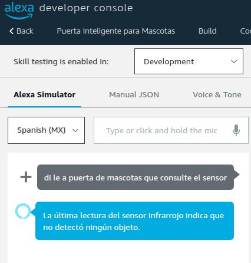
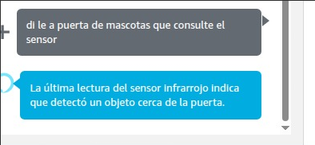
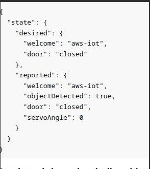
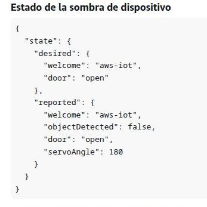
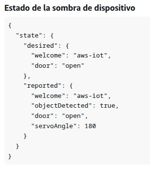
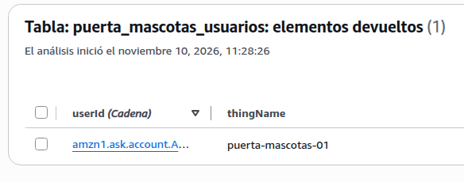
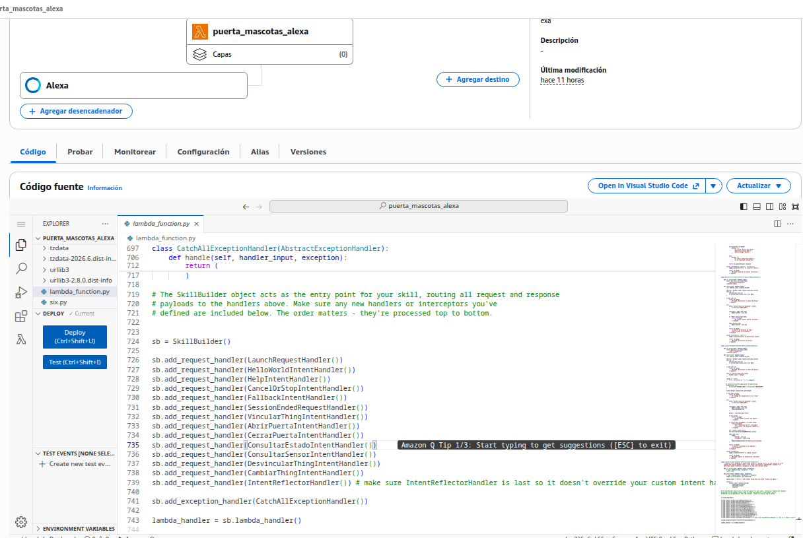
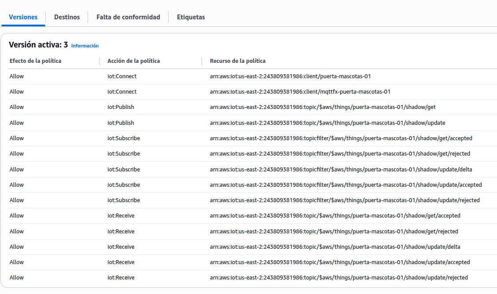
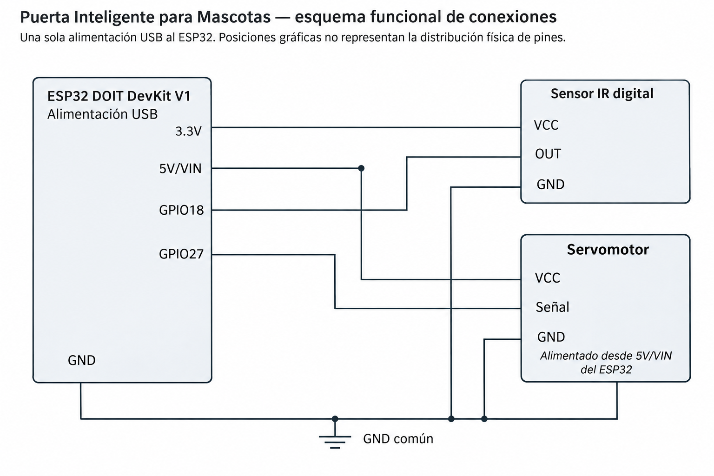

# Evidencias — Puerta Inteligente para Mascotas

## 1. Descripción

Esta carpeta contiene capturas de las pruebas realizadas durante la integración de Amazon Alexa, AWS Lambda, Amazon DynamoDB, AWS IoT Core y el ESP32.

Las evidencias respaldan el funcionamiento del sistema de control de la puerta inteligente y la consulta del sensor infrarrojo mediante Alexa.

## 2. Pruebas del sensor infrarrojo desde Alexa

### Sensor sin detección

**Resultado:** Alexa informa que la última lectura del sensor infrarrojo no detectó ningún objeto.

### Sensor con detección

**Resultado:** Alexa informa que el sensor infrarrojo detectó un objeto cerca de la puerta.

## 3. Pruebas del Device Shadow

### Puerta cerrada

**Resultado:** los atributos `desired.door` y `reported.door` muestran `"closed"`, mientras que `reported.servoAngle` indica `0`.

### Puerta abierta

**Resultado:** los atributos `desired.door` y `reported.door` muestran `"open"`, mientras que `reported.servoAngle` indica `180`.

### Detección del sensor en AWS IoT Core

**Resultado:** el Device Shadow muestra `reported.objectDetected = true`, demostrando que AWS dispone de la lectura reportada por el ESP32.

Los valores de `servoAngle` representan los ángulos informados por el firmware, no mediciones independientes de la posición física.

## 4. Vinculación de usuarios mediante DynamoDB

**Resultado:** se verificó el almacenamiento de una vinculación entre un usuario de Alexa y el Thing `puerta-mascotas-01` en la tabla `puerta_mascotas_usuarios`.

El identificador del usuario debe ocultarse en la imagen publicada para proteger su privacidad.

## 5. Backend de AWS Lambda

**Resultado:** se documenta la función `puerta_mascotas_alexa`, responsable de procesar las solicitudes provenientes de la Skill de Alexa.

El código fuente utilizado está disponible en `../lambda/lambda_function.py`.

## 6. Seguridad y política AWS IoT

**Resultado:** se documenta la configuración de la política `PuertaMascotasIoTPolicy`, utilizada para autorizar operaciones MQTT del dispositivo.

Los permisos configurados incluyen las operaciones `iot:Connect`, `iot:Publish`, `iot:Subscribe` e `iot:Receive`.

La documentación de la infraestructura se encuentra en `../aws/README.md`.

## 7. Validación del prototipo físico

Durante las pruebas de integración, el integrante responsable del hardware confirmó el movimiento físico del servomotor SG90 al ejecutar las órdenes de apertura y cierre desde Alexa.

La confirmación del movimiento físico complementa las capturas del Device Shadow, que por sí solas muestran estados reportados por el firmware.

La fotografía del montaje físico y cualquier evidencia adicional se incorporarán cuando estén disponibles.

## 8. Seguridad de las evidencias

Antes de publicar las capturas en GitHub, se debe verificar que no contengan claves privadas, credenciales, contraseñas, tokens ni identificadores personales completos.

Las imágenes deben mostrar solamente la información necesaria para demostrar los resultados técnicos.

## 9. Relación con el informe técnico

Estas evidencias respaldan las secciones de implementación, pruebas y resultados del archivo `../docs/informe.md`.

Los resultados registrados corresponden a las pruebas efectivamente realizadas y no implican mediciones sistemáticas de latencia, disponibilidad o estabilidad.

## 10. Diagrama de conexiones del circuito

**Figura:** Esquema funcional de conexiones entre el ESP32 DOIT DevKit V1, el sensor infrarrojo digital y el servomotor SG90.

El sensor infrarrojo utiliza el GPIO18 como entrada digital y recibe alimentación de 3.3 V.

El servomotor SG90 utiliza el GPIO27 como señal de control y recibe alimentación desde el pin 5V/VIN del ESP32.

Todos los componentes comparten una referencia de tierra común (GND).

El esquema representa las conexiones funcionales del circuito y no la distribución física de los pines en la placa.